# ANCOS Master System Audit and Architecture Blueprint

**Research and inspection date:** 2026-11-01
**Repository inspected:** `C:\Users\nandk\neural-company`
**Commit inspected:** `c9789df` (`feat: cognitive fabric, hybrid & agentic RAG, temporal GraphRAG, organizational MoE, and resource scheduler`)
**Audit boundary:** source, tests, configs, Docker files, dashboard, and read-only local runtime probes. The findings below describe the inspected commit and are a dated baseline, not a claim that the current working tree is unchanged.
**Working-tree caveat:** the dashboard has pre-existing uncommitted edits and two untracked image files from the prior dashboard task; those were left untouched. Findings about the dashboard reflect this working tree and should be reconciled with the committed baseline before a release.

## Implementation update — 2026-11-01

The owner authorized implementation after reviewing this audit. The first P0 truthfulness and local API boundary tranche is now applied in the working tree:

- DAG execution requires an explicitly supplied worker, and a worker result cannot complete a task without an independent verifier.
- Docker command execution no longer returns simulated exit code 0. Workstation provision, restart, termination, image build, emergency pause/resume, and command execution report unavailable/failed runtime operations instead of claiming a live state.
- The objective endpoint no longer auto-creates the fictional Alex Morgan and Maya Chen starter roster.
- Production API requests require a bearer token of at least 32 characters; production docs are disabled, CORS uses configured origins, and the development defaults bind locally. Compose publishes API and Redis ports on loopback.
- Production message delivery uses SQL persistence and Redis fanout; durable dispatch details and its at-least-once boundary are documented in `docs/DURABLE_MESSAGE_OUTBOX.md`.
- Docker socket access now belongs to a token-protected broker on an internal Compose network. The core API has no Docker socket mount or Docker API proxy; broker operations take typed employee IDs, an image allowlist, fixed mount target, bounded resources, named per-employee Docker volumes, loopback-only VNC ports, and fixed lifecycle/exec operations.
- The shared VNC password is removed from the workstation image. The broker generates an eight-character per-workstation password at provisioning, injects it into the container, and returns it only in the provisioning response. A token-protected rotation route can issue a replacement; the core manager does not retain passwords in its in-memory workstation registry.
- The dashboard now signs in with the owner token through a same-origin route, stores it in an HttpOnly/SameSite cookie, and forwards it server-side through a path-restricted API proxy. Compose keeps the dashboard/API published only on loopback and passes the token server-side; it is not exposed through `NEXT_PUBLIC_*` or browser storage.
- Task assignment now remains `ASSIGNED` until a worker starts; production status APIs cannot claim `RUNNING` without an authenticated worker claim, and the repository enforces a verifier receipt before completion by default. Assignment notifications return an explicit unavailable response instead of silently discarding delivery errors.
- Alembic now has a generated initial schema baseline. Development/test startup retains `create_all`; production startup requires the database to be stamped at the current migration head and never mutates schema automatically. The initial baseline blocks destructive downgrade; existing unversioned production DBs require backup, schema comparison, and an explicit stamp.
- Production message publishing now records the audit message and outbox row in one DB transaction. A lease-based dispatcher retries Redis publication with capped backoff and dead-letters after twelve attempts. This guarantees retryable publication to Redis, not consumer acknowledgement or task execution; consumers still need `message_id` deduplication.
- Task workers now have a separate bearer credential, a claim/start/heartbeat/submit/fail API, persisted attempts, lease expiry, and monotonically increasing fencing tokens. Claims require an assigned employee with a persisted running workstation, and the Docker broker refreshes live status before work starts. Submissions enter independent verification and cannot mark a task complete.
- A separately credentialed verifier API now lists fenced submitted attempts and records review receipts and `TaskResult` atomically with task completion. This is an API contract only; no independently operated verifier process or attestation is deployed.
- Task completion now requires a passing verification receipt in every environment; development settings and legacy `enforce_verification=False` arguments cannot disable this truthfulness gate.
- Static validation: Python bytecode compilation, dashboard TypeScript typecheck, `docker compose config --quiet` with validation-only tokens, Ruff, and `git diff --check` pass. The Alembic baseline, outbox, and task-attempt revisions upgraded a fresh SQLite database, `alembic check` reported no schema drift, and production startup accepted the current head while rejecting an unversioned database. API module import passed. The test suite has not been rerun after these edits. Docker runtime behavior remains unverified because the daemon is unavailable.

Tests have not been rerun. Still open from the P0/P1 work: auth/approval roles are not modeled; Redis Pub/Sub has no consumer acknowledgement/replay; no task-worker process or production GUI executor is wired, so the protocol cannot execute real work yet; worker/verifier identities are shared service credentials with no signed attestation; task-state and outbox insertion are not one transaction; migration of an existing populated database has not been exercised; Postgres deployment, resource/session leases beyond task leases, persistent memory, and the other roadmap items remain unimplemented. The dashboard owner-token proxy and Docker broker have only been statically inspected; Docker was unavailable in the inspected environment, so live behavior remains unverified. Existing dashboard edits were not changed.

## 1. Executive summary

ANCOS has a broad and unusually complete **prototype surface**: persistent SQL models for employees/projects/tasks, a project/task DAG, a model gateway, real local Laya weights and inference tests, container hardening code, GUI perception/action modules, governance and audit records, retrieval prototypes, desktop slot and checkpoint classes, and dashboard rendering. The latest commit is a large systems prototype, not evidence that the described autonomous company is operational end to end.

The decisive gap is the execution path. The Boss endpoint can create a project and tasks, but it also seeds two named employees into an empty company. The DAG scheduler's default worker returns synthetic success, while the container manager reports successful simulated command output when Docker is unavailable. No durable worker service is wired to consume the task assignments and execute employee work. Therefore a green test or `COMPLETED` state does not currently prove that an ANCOS employee performed the work.

Security is also a release blocker: the API has no request authentication/authorization middleware in its application setup, uses permissive CORS, and ships with a default secret. Docker provisioning is brokered in application code, but the Compose socket proxy exposes a broad Docker API surface to the core service. In this environment the Docker CLI is installed but the daemon is unavailable; API port 12000 and Redis port 6379 are also closed. Live container, Redis, and provider behavior could not be verified.

`uv run pytest -q` completed successfully: **370 passed in 55.62 seconds**. The suite includes genuine local Laya checkpoint inference (the checkpoint file is present, about 843 MB), but emitted seven calibration warnings. Most Docker tests verify broker specs and use the manager's no-daemon path; they do not prove isolation in a live Docker runtime. The E2E acceptance test constructs artifacts and invokes local test commands itself; it does not exercise an autonomous employee worker from objective through delivery.

**Recommendation:** do not rewrite the project. First remove success-shaped simulation from production paths, close API and Docker control-plane boundaries, and introduce durable work/event contracts. Preserve the existing Python/FastAPI, SQLAlchemy, employee, task, verification, and GUI modules where they pass real-path tests. Keep the four-desktop limit only as an administrative ceiling; calculate effective admission from measured host and workload resource use. Keep SQLite for local development if useful; use a migration-backed transactional database for multi-worker production. Treat Temporal as a candidate to benchmark for long-lived workflow durability, not an automatic dependency.

**Approval and execution status:** owner approval to begin implementation was received on 2026-11-01. Work is proceeding in the order and risk sequence in Sections 19–23; the update above records the first completed tranche and remaining gaps.

## 2. Repository audit and verified current state

### 2.1 Repository inventory

The repository contains a Python 3.12 FastAPI backend under `services/core/neural`, a Next.js dashboard under `apps/dashboard`, SQLAlchemy models and repositories, YAML policy/model/resource configs, Docker Compose and employee/core images, architecture/PRD/plan documents, and **370 collected and passing pytest cases** across unit, integration, and one E2E file. Major code areas include:

| Area | Main paths | Current evidence-based assessment |
|---|---|---|
| API and persistence | `services/core/neural/api/`, `db/` | REST routes and SQLAlchemy async repositories exist. Startup calls `Base.metadata.create_all`; there is no Alembic environment or migration history in the repo. |
| Boss and DAG | `boss/`, `tasks/` | Planning, dependency graph, assignment, retries, and a callable DAG loop exist. The default DAG worker is a sleep followed by `{"status":"success"}`; no production worker registration is present. |
| Employees and skills | `employees/factory.py`, `skills/`, SQL models | Database-backed dynamic IDs and unverified skills exist. `/boss/objective` invokes a bootstrap routine that creates Alex Morgan and Maya Chen on an empty roster. |
| LLM | `llm/`, `configs/model-routing.yaml` | Multi-provider gateway, retry/circuit and cost tracking code exist. Runtime provider execution was not tested live; some fallback paths are heuristic. |
| Laya | `decision_intelligence/system_one/`, `data/models/laya/` | Real checkpoint, hash registry, torch inference, typed schemas, routing, shadow/evaluation code exist. The full test suite ran local model tests; current calibration metadata triggered warnings. |
| GUI | `gui_intelligence/`, `sandboxes/` | Screenshot, visual grounding, mouse/keyboard, action receipts, recovery and GUI safety modules exist. Synthetic/mock capture paths are extensive; no live desktop was available. |
| Containers | `containers/`, `docker/`, `docker-compose.yml` | Broker validates names/mounts and hardens launch kwargs. Manager can fall back to an in-memory spec and simulated command success when Docker is missing. |
| Desktop pool | `resource_scheduler/` | Four-slot profile, queue, lease, checkpoint and resource monitor classes exist. Slot/lease/queue state is process-local; checkpoint JSON records orchestration metadata, not a verified application snapshot. |
| Memory and retrieval | `memory/`, `cognitive_fabric/` | Six-layer data structures, hybrid retrieval, agentic loop and graph traversal exist. Several backing structures are process-local; Chroma is created via `chromadb.Client()` and embeddings default to deterministic token-hash projections, not a learned semantic encoder. |
| Governance | `governance/`, `security/approval_gates.py` | Proposals, votes, ledger, approvals and kill switch code exist. Enforcement coverage at API/action boundaries is incomplete; an LLM's output cannot be treated as authorization. |
| Learning | `evolution/`, `methods/`, `tools/` | Failure pattern rules, prompt suggestions, method/tool experiments and DB records exist. Some score outputs are hard-coded estimates; tests of these modules do not establish improvement in production workflows. |
| Backup and audit | `ops/backup.py`, `observability/`, DB models | SQLite backup, checksum manifest, archive and restore code plus hash-chain audit helpers exist. Encryption, off-host rotation, signed identity, restore threat model and clean-room live recovery are not established by source inspection alone. |
| Dashboard | `apps/dashboard/` | Next UI and Canvas world components exist. Current tree includes uncommitted visual edits. Backend disconnection was observed in prior work; this audit's live API probe confirms port 12000 is not listening. |

**Evidence anchors for high-impact findings:** CORS is configured in `services/core/neural/api/main.py:58`; the in-memory bus is selected in `services/core/neural/api/deps.py:198`; empty-roster bootstrap is called by `services/core/neural/api/routes/boss.py:32` and creates Alex/Maya in `services/core/neural/employees/factory.py:319-344`; scheduler's default success worker is `services/core/neural/tasks/scheduler.py:270-275`; simulated Docker success is `services/core/neural/containers/manager.py:412-417`; the default secret and SQLite URL are `services/core/neural/config.py:16,22`; `create_all` is `services/core/neural/db/engine.py:39`; deterministic hash embeddings and default Chroma client are `services/core/neural/cognitive_fabric/retrieval/vector_store.py:12,61`; in-memory graph dictionaries are `services/core/neural/cognitive_fabric/knowledge_graph/temporal_graph.py:30-31`; Docker proxy scope is `docker-compose.yml:20-34`; and hardcoded 64 GB/16-slot profile is `services/core/neural/resource_scheduler/hardware_profiler.py:60-63`.

### 2.2 Subsystem-level audit matrix

This matrix distinguishes intended behavior in repository plans/docs from executable behavior inspected in source. “Tests” names real code paths; no row implies a live service integration unless explicitly stated.

| Subsystem; intended responsibility | Actual implementation and callers | Tests / evidence | Failure modes, security and performance gaps | Next action |
|---|---|---|---|---|
| API gateway; owner/control API, auth, REST/events | FastAPI routers registered in `api/main.py`; dashboard calls REST. No WebSocket handler or request auth middleware/dependency found. | `tests/integration/test_phase*_api_endpoints.py`, decision and GUI route tests use test app/DB. | Wildcard CORS, default signing secret, unauthenticated mutations; live port closed. No rate/abuse limits proven. | Auth, scope checks, CORS and startup secret validation before network exposure. |
| DB/schema; durable company truth | SQLAlchemy async engine, repositories, SQLite default; Postgres/asyncpg dependencies. Startup `create_all`. | Most fixtures create in-memory SQLite schema via `tests/conftest.py`. | No migration history; SQLite single-writer constraints; uncertain production transaction boundaries on multi-repository actions. | Alembic baseline, transactional APIs/outbox, Postgres production path with migration/rollback test. |
| Boss; interpret goals, plan and coordinate | `/boss/objective` creates `BossBrain`, calls plan/create and first-task assignment. Boss plan relies on `TaskPlanner`; no persistent Boss controller loop. | Boss/unit and phase integration tests cover planning/persistence. | Endpoint bootstraps Alex/Maya if empty. Planned task is not necessarily executed. No durable monitoring loop or real deep cognition fallback. | Remove auto-bootstrap; separate proposal, approval, orchestration and reporting. |
| Workforce; identity, lifecycle, skills | Factory creates DB employees and employee workspace dirs, role config and unverified skill rows; API CRUD uses repositories. | Factory, lifecycle and skill certification tests. | Hardcoded bootstrap names; default fallback skills can create broad-looking claims (though `verified=False`); no worker runtime identity binding. | Preserve factory but require explicit recruitment and verified evidence; normalize departments/memberships. |
| Task DAG/scheduling; dependencies, fairness, retries | SQL tasks/dependencies + in-process `asyncio.Lock`, active sets, optional worker callable and priority selection. | DAG, scheduler and resource scheduler unit/integration tests. | Default DAG worker returns success; process-local locks/active state do not coordinate replicas; task can be marked RUNNING without execution or assignee. | Durable claim/attempt rows, atomic leases, idempotency, registered executor only, false-success regression tests. |
| Execution fabric; GUI, terminal, browser, hybrid, tools | GUI controller modules; container `exec_run`; generic tools registry; API assignment only publishes message. | GUI synthetic-frame tests, workstation manager tests, skill/tool tests. | No unified task contract/mode router/workers. No live Browser/terminal/GUI end-to-end. Docker fallback returns exit 0. | Add typed contract and dedicated worker consumers; enforce mode/permission at broker. |
| LLM gateway; provider routing, reliability, budgets | `llm/gateway.py`, retry/cost; YAML tiers; provider SDK dependencies. Boss/meeting/routes obtain gateway through dependency singleton. | Unit tests for retries, routing, budgets; no provider secrets/live status verified. | In-memory cost records until persistence called; fallback may be simulated/heuristic; model IDs drift; no live outage test. | Pin provider model IDs/config, persist every call/usage, distinguish unavailable vs fallback and fault-inject. |
| Laya/System 1; bounded typed decisions | Registry/hash checks, local Torch adapter, batched inference, calibration/router/shadow records. | P0 test run loaded real local checkpoint for typed inference. Seven temperature warnings. | English model language scope, calibration questionable; `System2` fallback is lexical heuristic. Inference resource P95 not established. | Shadow mode, labeled holdout and calibrated abstention; no authorization or visual-perception role. |
| GUI intelligence; observe, ground, act, verify | Screen capture, pixel/OCR/object detection, pyautogui controllers, world model, risk checks and receipts. | Phase7/8 tests rely heavily on synthetic/mocked frames and controls. | Actual VNC unavailable; no evidence that full chain uses live screenshots; internal synthetic visual actions can influence test capture. | Hardware-free unit labels plus isolated live-desktop test with actual before/after captures. |
| Docker/container; provision isolated employee runtime | `RestrictedDockerBroker` validates names, image, mounts and kwargs; `ContainerManager` maps ports and stores spec; Compose has socket-proxy service. | P0 tests broker specs/deny paths and default manager. No Docker daemon available. | Socket proxy enables broad POST/volume/network/image operations; manager simulates availability and command success if daemon fails. Per-action broker auditing not live-tested. | Narrow daemon API and test on disposable real Linux/WSL runtime before employee execution. |
| Resource scheduler; slot admission and resumption | Static profiles, `psutil` monitor, in-memory pool/queue/lease manager, JSON checkpoint files. | Resource and recovery unit tests; mock resource metrics used. | Profiles hardcode 4/8/16; config says 10 employees at 4GB; no persisted fencing or concurrency benchmark; checkpoint not app snapshot. | Measure workloads and make persistent lease/atomic admission; cap from actual reserved headroom. |
| Communication/events; employee messages and real-time state | MessageBus supports Redis Pub/Sub and in-memory backend; DB message repository/audit; API dependency sets `prefer_in_memory=True`. | Comms bus and phase integration tests. | Pub/Sub volatile, default process-local; failures are often caught and ignored; no outbox sequence/replay; no WebSocket. | Transactional outbox + durable consumers; fanout is separate and recoverable. |
| Memory/RAG/graph; recall and company knowledge | DB `memory_entries`, in-memory six-tier store, lexical BM25, deterministic hash vectors, optional Chroma client, NetworkX temporal graph and bounded agentic loop. | Cognitive fabric retrieval/memory/graph tests. | Canonical record persistence is not connected to all stores; Chroma client not configured persistent; graph is process-only; ACL enforcement not durable/per-hop; GraphRAG synthesis formats snippets. | SQL canonical records/ACL; FTS and temporal edges first; measure before semantic embedding/global GraphRAG. |
| Governance/approval; owner sovereignty | Proposal/vote/decision ledger and approval records/routes; kill switch registration across services. | Phase3 governance and phase6 approval/kill-switch tests. | No API auth undermines actor identity; action-level gate coverage not comprehensive; UI approval payload needs hash binding. | Route/action inventory and deny-by-default enforcement with exact-payload approval. |
| Meetings/comms; evidence-based coordination | Meeting/participant/report/conductor/minutes/action item modules and SQL models. | Boardroom and meetings integration tests use repositories/fakes in hermetic env. | LLM fallback can be heuristic; actual participant reports/current work not live verified; no event-stream freshness proof. | Use DB receipts as report inputs; mark missing report as missing, not invented. |
| QA/verification; separate evidence acceptance | `evaluation/verifier.py`, visual verifier, task result/skill certification records. | Verification and phase4 tests; E2E manually generates outputs. | Scheduler verification optional; test exit code may be supplied by caller; cryptographic SHA-256 signature is not an authenticated digital signature. | Require independent verifier service identity; bind receipt to artifact hashes and raw logs. |
| Learning/self-improvement; measured changes and rollback | Failure analyzer, prompt optimizer, Toolsmith, MethodLab, evolution records, decision shadow/promotion. | Phase4/5/8 unit tests. | Fixed 0.68/0.92 scores and proactive “improvement” when no failures; protected branch/real code deployment absent. | Replace constants with frozen benchmark receipts; no promotion without measurable benefit + approval. |
| Observability/audit; company-wide causal trail | structlog, custom metrics, DB audit chain verifier, decision history. | phase6 observability and audit unit tests. | No OTel export/traces/alerting; hash chain stored in same mutable DB; task-event correlation not universal. | Propagate trace/correlation IDs; signed external checkpoints and alert tests. |
| Backup/recovery; restore company truth | Hot SQLite backup, SHA-256 manifest, tar packaging, DB integrity check in restore path. | `tests/unit/test_disaster_recovery.py`. | No encryption/off-host rotation proven; model weights/session credential posture unclear; clean-room test only local source tests. | Define RPO/RTO, encrypt/externalize, signed manifest and restore into isolated fresh target. |
| Dashboard; show real company state | Next.js dashboard with Canvas environment/character/world renderers and REST client; current tree dirty from previous visual task. | Previous build passed; no current backend session. | No live data available; no server event stream; render correctness cannot stand in for actual company execution. | Treat UI as a projection; seed isolated events and compare every state to API truth. |
| Benchmark; prove quality and 4× speed | OSWorld runner, human speed comparator, cognitive/task scorecards. | Unit tests exercise score helpers; no certified human trials. | Simulated/mocked runtime and human estimates can contaminate scores; no benchmark version lock. | Pin official release/tasks; compare same app/data/state, all latency/retries/QA and quality. |

### 2.3 Capability classification

`VERIFIED_BUILT` here means code plus an appropriate test was run in this workspace. It does **not** mean production deployment or external integration was verified.

| Capability | Classification | Evidence and limit |
|---|---|---|
| SQL persistence for core entities | `VERIFIED_BUILT` | `db/models.py`, `db/repositories.py`, test fixture creates/drops schema in an in-memory SQLite DB. Production migration/restore was not run. |
| Dynamic employee creation and skill records | `PARTIALLY_BUILT` | `EmployeeFactory` writes records and initializes skills `verified=False`; objective endpoint bootstraps fixed named workers, contrary to empty-company invariant. No persistent worker process was verified. |
| Objective decomposition and task DAG | `PARTIALLY_BUILT` | `BossBrain`, `TaskPlanner`, `TaskScheduler`, graph unit/integration tests. Plan generation and DAG persistence work in tests; actual worker execution is not wired. |
| Task completion/verification semantics | `MOCK_OR_SIMULATED` | Optional verifier path exists, but scheduler default worker returns success; verification defaults off unless injected. Completion can mean synthetic worker returned, not delivered artifact. |
| Actual Laya inference | `VERIFIED_BUILT` | Checkpoint exists; P0 test asserts Torch runtime and runs CHOICE/SCORE/NOUL. Confidence calibration remains suspect (seven invalid temperature warnings). |
| Deep reasoning escalation | `MOCK_OR_SIMULATED` | `EscalationController` uses overlap/keyword heuristics and adds 35 ms to the reported latency unless a real `deep_brain_handler` is injected. |
| Container isolation specification | `VERIFIED_BUILT` | Broker tests reject unsafe name/mount and enforce user/capabilities/no-new-privileges. Live Docker daemon isolation was not tested. |
| Container task execution when Docker is absent | `MOCK_OR_SIMULATED` | Manager returns `[SIMULATED]` output with exit code 0 after daemon/exec failure. This must never feed a verified task result. |
| Resource-aware desktop session pool | `PARTIALLY_BUILT` | Four-slot state, queue, basic resource checks, leases and JSON checkpoints are tested; state is local/in-memory, no fencing token, and no real four-way load measurements. |
| Memory/RAG/GraphRAG | `PARTIALLY_BUILT` | Retrieval APIs and test fixtures exist. Current stores are largely in-memory, hash embeddings are not semantic, graph is NetworkX process state, synthesis is evidence formatting rather than LLM grounded synthesis. |
| Redis durable task/message processing | `DESIGNED_NOT_IMPLEMENTED` | Redis Pub/Sub exists, but API dependency explicitly selects `prefer_in_memory=True`; Pub/Sub is not a durable job/event log. `arq` is in dependencies but no worker entry point is wired. |
| Human approvals and governance | `PARTIALLY_BUILT` | Approval and ledger entities/routes exist. No authentication protects the API routes; therefore a recorded approval workflow is not yet a trustworthy owner authorization boundary. |
| Self-improvement | `MOCK_OR_SIMULATED` | Prompt optimizer outputs fixed baseline/optimized scores (0.68/0.92); no measured before/after evidence is required for that returned percentage. |
| Backup/restore | `PARTIALLY_BUILT` | SQLite online backup and SHA-256 component manifest exist; source tests cover local operations. Encryption, external copy, immutable retention and adversarial archive input are unproven. |
| 4× speed objective | `DESIGNED_NOT_IMPLEMENTED` | Human speed module and benchmark helpers exist, but no certified workflow dataset or matched multi-trial human baseline was run. |
| Live API, Redis, Docker, VNC | `BLOCKED` | Read-only probes: Docker client 29.8.2, no Docker daemon pipe; TCP 12000 and 6379 closed. No live backend/provider task was run. |

### 2.4 Runtime baseline

Read-only local checks on 2026-11-01 found: Docker client 29.8.2 but no Docker Desktop Linux engine; `127.0.0.1:12000` closed; `127.0.0.1:6379` closed. No production credentials were read or printed. The model file `data/models/laya/base/model.safetensors` exists (842,609,210 bytes; timestamp 2026-09-24). The full test run used local model assets and hermetic test DB fixtures, not live API/Redis/Docker services.

### 2.5 Existing tests: strength and blind spots

The suite exercises many deterministic contracts and unit/integration code paths. The `tests/conftest.py` fixture uses in-memory SQLite and `create_all`; the Docker P0 provisioning test instantiates the default manager without proving a real daemon; the Laya P0 tests do run actual local weights; and `tests/e2e/test_autonomous_acceptance_mission.py` creates workspace artifacts and launches pytest/subprocess from the test itself. There is no demonstrated full path in which a real employee runtime receives a task, performs work, emits a durable receipt, and then passes independent QA.

Do not use test count as a company capability score. Add test labels and CI jobs that separate pure unit tests, hermetic service integration, live-model tests, Docker-runtime tests, and owner-facing acceptance. Keep live-provider tests opt-in and redact secrets.

## 3. Complete requirements map

The traceability rows below condense the complete vision-to-implementation matrix. The acceptance matrix in Section 21 expands each owner scenario into a measurable proof.

| Vision / requirement | Existing implementation and evidence | Classification / material gap | Proposed acceptance proof |
|---|---|---|---|
| One owner, one Boss, dynamic workforce | Boss API, employee factory, DB employee table, skill registry | Partial; auto-seeds named roster and has no worker process integration | Empty DB remains empty; owner request creates only the needed employee and onboarding receipt. |
| Project DAG coordination | `boss/planner.py`, `tasks/dependencies.py`, `tasks/scheduler.py` | Partial; DAG exists, worker execution is default simulated success | Worker-backed integration executes two dependent tasks and blocks successors until verified predecessor. |
| Universal task execution | GUI controllers, Docker command manager, tools registry | Partial; no task execution contract or mode dispatcher joining modules | Contract tests prove allowed modes only; GUI-only task cannot invoke hidden APIs/CLI. |
| Persistent employees; ephemeral sessions | Employee/workspace plus container records; resource scheduler checkpoint JSON | Partial; lease/slot state in memory; no fencing; session vs workspace contract incomplete | Repeated session teardown/reacquire across API restart preserves employee/workspace and rejects stale fencing token. |
| LLM routing and budget | Gateway/provider tiers/retry/cost records; Laya router | Partial; no live provider outage test; some fallback estimates are synthetic | Provider fault-injection proves cap, one fallback, idempotent task state and truthful model attribution. |
| Memory/RAG and privacy | six-tier schema-like models, RBAC filters, BM25/vector, graph | Partial; volatile stores and permission checks not cross-process/DB enforced | Employee A cannot retrieve B-private memory through direct or graph traversal; source provenance survives restart. |
| Governance and approvals | proposals/votes/approval rows/kill switch/audit chain | Partial; API auth missing, action-level approval gates not consistently demonstrated | Unauthorized caller cannot create/approve/execute sensitive action; signed owner approval is single-use and audited. |
| Self-improvement with rollback | tool/method/evolution records, benchmark code | Mock/partial; fabricated 0.68→0.92 score output; no real protected promotion loop | Controlled branch must beat locked baseline with confidence interval, pass security suite and explicit approval; rollback tested. |
| Meetings and company communication | meeting, minutes, action-item APIs and DB models | Partial; no confirmed durable realtime stream; fallback deliberation may be heuristic | Meeting includes actual participants/reports and creates attributable action items; no invented attendee or progress. |
| Truthful live dashboard | API routes and Canvas renderers | Partial; no event stream; statuses may be inferred/polled and backend unavailable | Seed test records, emit lifecycle events; UI matches persisted state and disconnect state, no synthetic activity. |
| Resource-aware desktop operation | fixed hardware profiles and resource monitor | Partial; configured 4/8/16 slots, not measured admission; other config allows 10 concurrent employees | 1–4 slot benchmark with P95/high-water telemetry; admission drops before host reserve threshold. |
| Backup and recovery | hot SQLite backup, checksums, archive restore and integrity check | Partial; no encrypted off-host/immutable backup or real crash recovery evidence | Clean-room restore from latest external backup with DB integrity, manifest check, artifact checksums and owner report. |
| 4× speed with quality | human-speed and GUI benchmark modules | Research/measurement required | Certified identical tasks, same start state, multiple human and ANCOS runs; include retries, latency, QA and failures. |

## 4. Research findings

Research checked on **2026-11-01** against official project releases/docs and primary papers. Benchmark results below are not production guarantees.

### Computer-use benchmark landscape

| Benchmark | What it tests / maturity at research date | ANCOS use |
|---|---|---|
| OSWorld 1.x / OSWorld-Verified | Open-ended real desktop/web applications; maintainers published Verified updates and execution-based scoring. Useful baseline, with environment and version pinning required. | Keep for regression comparability; do not treat a single aggregate score as task competence. |
| OSWorld-V2 | Official releases page shows **`osworld-v2.1` as latest** at research time, with 108 long-horizon tasks and pinned task/assets/runtime components. No 2.2 release was assumed. | Primary long-horizon GUI candidate; pin release and assets, publish task-level scores. |
| DynamicGUIBench | 149 online GUI tasks across 10 applications, targeting transient/hidden state between observations; recent preprint/repository. | Add a small dynamic-state subset after live screenshot capture and interaction telemetry are reliable. |
| WindowsWorld | 181 cross-application professional tasks across 17 apps; recent preprint. Strong fit for cross-app workflows but simulated environment/task maturity should be stated. | Use as diagnostic cross-app test, not sole release gate. |
| WeaveBench | 114 long-horizon tasks requiring GUI plus CLI/code in the same trajectory, with trajectory-aware evidence and shortcut detection; 2026 paper/repository. | Best fit for explicit hybrid execution contract and anti-shortcut evaluation. |
| OSWorld-Human | Studies action/time efficiency relative to human task performance, not only success. | Use to design a matched baseline and reduce unnecessary action/reasoning loops. |
| MacAgentBench | 676 macOS tasks across 25 apps, almost 60% mixing GUI and CLI; recent paper/repository. | Not a direct execution target for the Linux/Xfce desktop, but useful cross-platform workflow/metric insight. Do not provision macOS hardware unless the owner adds macOS as a product requirement. |

### Memory and retrieval

ANCOS has a strong prototype decomposition (working/episodic/semantic/procedural/relational/organizational/person/project decision memories, permission models and consolidation helpers) but it must be made durable and permission-enforced. Keep one retrieval facade over SQL/full-text + optional vector index + relational graph. Start with BM25/SQLite FTS and a simple measured vector index; only select learned embeddings after a retrieval set shows lift. Agentic RAG should be capped by rounds, latency and cost and return citations to source artifact IDs. Microsoft's GraphRAG distinguishes entity-oriented local retrieval from corpus-wide community/global retrieval; its original paper builds a graph index and community summaries for corpus-wide query-focused summarization, a comparatively expensive capability not required for task-state lookups. Use only after corpus-wide synthesis needs are measured. A relational edge table in the main DB is enough for ANCOS's first temporal graph; do not add Neo4j without a benchmark showing a query or scale need.

### Model intelligence and Laya

Neural sparse MoE selects parameter experts inside one neural network; organizational MoE chooses an employee/team/model/runtime. ANCOS's `organizational_moe/` is the latter and does not make the LLM itself a sparse MoE. Keep the separation in API names and metrics. Model routing should optimize task quality subject to an explicit budget/latency constraint, compare a static capability rule baseline against learned routers, and maintain a fallback that is honestly labeled.

The local Laya integration is the clearest genuine model component. Project materials describe specialized English, multilingual and typed-decision checkpoints; the repository's actual test run confirms Torch inference on the local checkpoint. The current seven calibration warnings mean outputs using affected entries cannot be treated as calibrated probabilities. Run shadow mode, fit temperature on a versioned in-domain holdout, measure ECE/Brier/selective risk by language/task, and route to a real reasoning handler only after that handler is wired. The current escalation fallback is lexical heuristics with synthetic latency, not System 2 reasoning.

### Execution, lifecycle and reliability

Docker provides CPU/memory constraints and default seccomp/capability layers, but containers still share the host kernel. Rootless Docker can reduce daemon/container privileges but has documented feature limitations including checkpoint support; it needs a Windows/WSL compatibility POC. Docker's checkpoint/restore CLI remains documented as **experimental** and uses CRIU, so it must not be a required recovery primitive. Persist files/workspace artifacts and an explicit resumable task checkpoint; reacquire a clean session and observe the real desktop before continuing.

Kasm Workspaces provides a managed workspace option and browser access, but commercial licensing varies by concurrent sessions; Community Edition is limited to eligible non-commercial/evaluation use, and S3 Persistent Profiles V2 remains marked experimental in its docs. KasmVNC can be evaluated as a streaming component, but adopting full Kasm adds operational/licensing weight. Benchmark against the existing Xfce/TigerVNC/noVNC image first.

Temporal offers durable workflow history/replay and retry/idempotency primitives (Python SDK/server are MIT licensed), but adds another stateful service and operational footprint. It is a candidate for a small pilot around long-lived project workflow, approval waits and retry recovery. Compare it with a simpler Postgres-backed state machine + transactional outbox under crash/restart and 16 GB resource tests before selecting it.

### Security, observability and schema changes

Use OWASP LLM Top 10 2025 as the minimum agent threat taxonomy: prompt injection, sensitive info, supply chain, unsafe output, excessive agency, vector/embedding weaknesses and unbounded consumption are directly relevant. Controls must be enforced in APIs/brokers, not model prompts. OpenTelemetry's traces, metrics and logs provide a vendor-neutral instrumentation model that can extend the current structlog/custom metrics.

Alembic is already a dependency but no migration environment was found. Use migration scripts with tested upgrade and rollback paths; do not use `create_all` as production schema evolution. SQLite WAL helps readers and writers coexist but still allows only one writer at a time and is single-host, so it suits a single-user/dev install, not a multi-process distributed company data plane.

## 5. Technology comparison and recommendations

| Concern | Option | Maturity / license / maintenance | ANCOS integration and resource trade-off | Recommendation |
|---|---|---|---|---|
| Core DB | SQLite + SQLAlchemy (existing) | Mature, permissive public domain; bundled, low ops. WAL still one writer and same-host. | Lowest initial footprint; tests already use it. `create_all` needs replacement by migrations. | Keep for local/single-process dev and hermetic tests; not production multi-worker source of truth. |
| Core DB | PostgreSQL + SQLAlchemy/Alembic | Mature, PostgreSQL License; well-supported upstream. | Adds service/resources but supports concurrent workers, transactions, constraints and outbox. | Production target once migrations and backup/restore are verified. Use Postgres also for FTS/relational graph initially; avoid a second DB. |
| Event delivery | Redis Pub/Sub (existing) | Mature, low latency. License depends on exact Redis version; Redis 7.4+ and 8 have non-BSD licensing choices. | Repo already includes Redis container; Pub/Sub drops events for disconnected subscribers and is not a durable task queue. | Keep only for transient fan-out. Pin exact image/license and use durable DB outbox/queue for work. |
| Event delivery | DB transactional outbox + worker | Established pattern; no new service or license. | Small schema/worker cost; requires claim/lease/retry logic. | First reliable delivery baseline before adding another workflow engine. |
| Durable workflows | Temporal | Mature OSS ecosystem; MIT Python SDK/server; service/worker deployment and replay compatibility work. | Best durability for multi-hour tasks/human waits, but nontrivial RAM/ops. | Run bounded POC vs existing state machine/outbox; adopt only if it materially reduces recovery risk. |
| Desktop | Docker + current Xfce/VNC/noVNC | Mature runtime; Docker Engine Apache-2.0, components have own licenses. | Reuses images and broker; CPU/RAM must be measured under actual display/browser/model load. | Keep; harden daemon access and test live on supported Linux/WSL host. |
| Desktop platform | Kasm Workspaces / KasmVNC | Maintained product; Workspaces Community use/license has restrictions, concurrent caps; KasmVNC GPLv2 per official docs. | Faster workspace control but licensing and platform layer add footprint. | Do not replace current runtime yet; benchmark session setup, auth, profile isolation, resource and license fit. |
| Memory retrieval | Existing BM25 + hashed vectors + optional Chroma | BM25 mature; current hashed embedding is deterministic lexical feature projection, not semantic model. Chroma is installed but current `Client()`/dict path is not durable. | Low inference cost; weak semantic and persistence guarantee. | Persist canonical memories in SQL; compare FTS/BM25 and a model embedding on labeled queries before enabling vector service. |
| Graph retrieval | SQL relational graph vs Microsoft GraphRAG | SQL graph edges are simple and transactional; GraphRAG is maintained but indexing/LLM cost can be high; exact library license/dependency review must be done at selected commit. | Existing graph is in-memory NetworkX and current GraphRAG just formats retrieved evidence; large graph DB unnecessary. | Persist normalized entities/edges and temporal predicates in PostgreSQL first. Evaluate Microsoft GraphRAG only for global corpus questions. |
| Model routing | Deterministic capability/budget rules | Easy to explain/replay, no model license. | Near-zero added memory/latency. | Baseline and safety guard for all routes. |
| Model routing | Learned/router model, RouteLLM-type | Active research; router quality/cost gains vary by model set/dataset. RouteLLM is open source, but benchmark should be rerun on ANCOS tasks. | Adds evaluation data, maybe embeddings/model serving. | Shadow compare; promote only with ANCOS task quality + realized-cost evidence. |
| System 1 | Laya | Checkpoint and SDK actively maintained per project; Hugging Face model card declares Apache-2.0 (verify exact revision and dependency licenses before redistribution). | 421M-class checkpoint resource cost; current weights present. Existing calibration warning is a quality risk. | Keep advisory/shadow only until in-domain calibration and abstention thresholds pass. Never authorize tools. |
| Telemetry | Custom structlog/current metrics | Existing lightweight implementation. | Low overhead, but no standard trace propagation/export shown. | Keep event schemas; export through OpenTelemetry before considering a vendor backend. |

No benchmark proves a fixed number of desktops safe on 16 GB or 64 GB. Profile A may have a configured cap of four, but admission must be lower if measured P95 usage plus host reserve exceeds available resources. Profile B must be measured; the current hardcoded 16-slot 64 GB profile is not evidence and should not be used as a capacity promise.

## 6. Unified target architecture

### 6.1 System context diagram

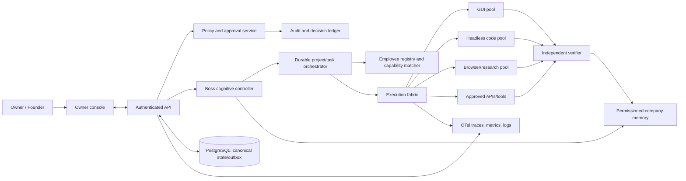

### 6.2 Component architecture

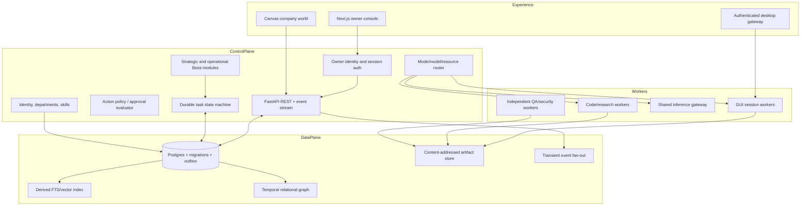

### 6.3 Boss cognitive architecture

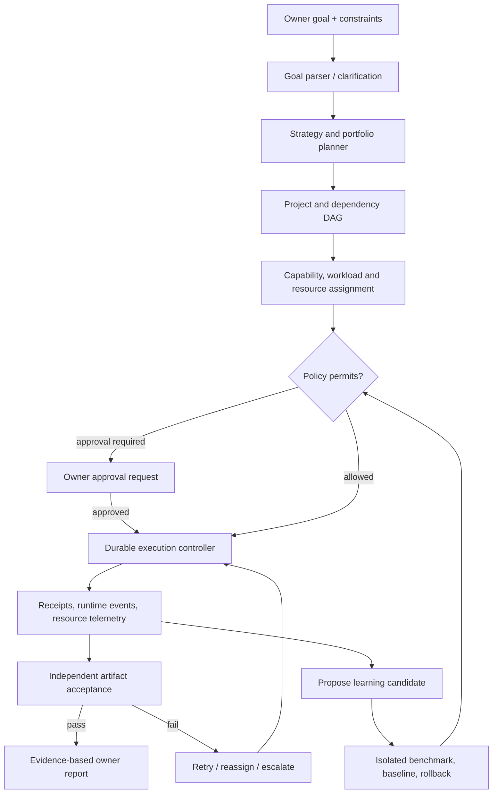

Strategic, operational, fast-decision, policy, execution and verification are distinct services/contracts. Boss reasoning proposes actions; policy independently authorizes; workers execute; verifiers decide evidence sufficiency.

### 6.4 Employee lifecycle

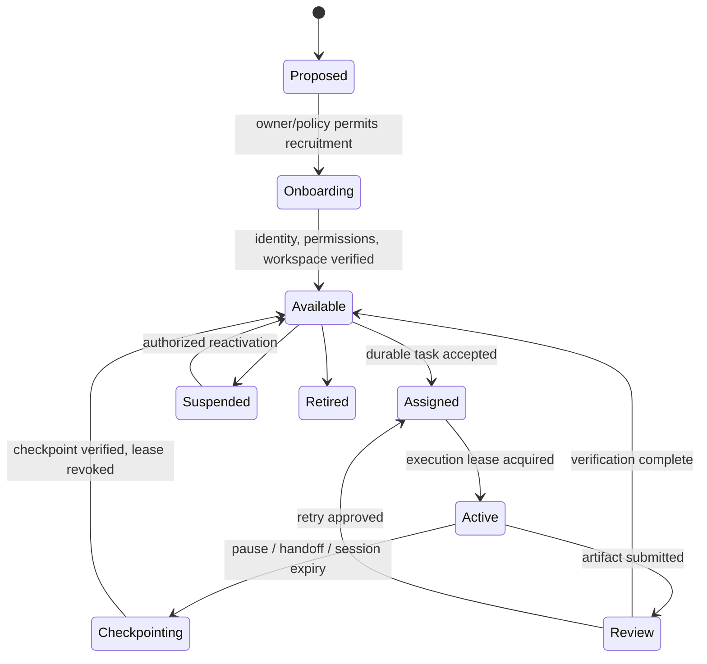

### 6.5 Task execution flow

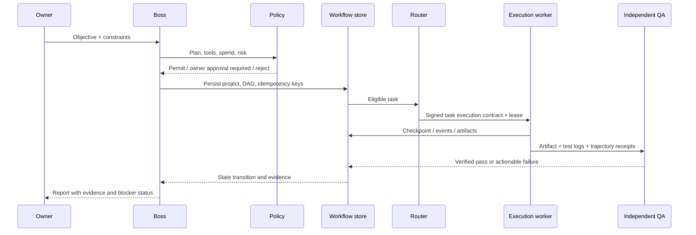

### 6.6 Execution-mode routing

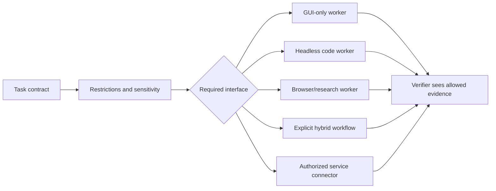

Every task persists `allowed_modes`, `forbidden_interfaces`, `approved_tools`, scope, data classes, network policy, time/budget ceilings, expected evidence and approval requirements. The worker broker enforces this contract. GUI-only tasks cannot reach DOM, accessibility, app APIs or CLI; hybrid tasks name each permitted interface.

### 6.7 Desktop lifecycle

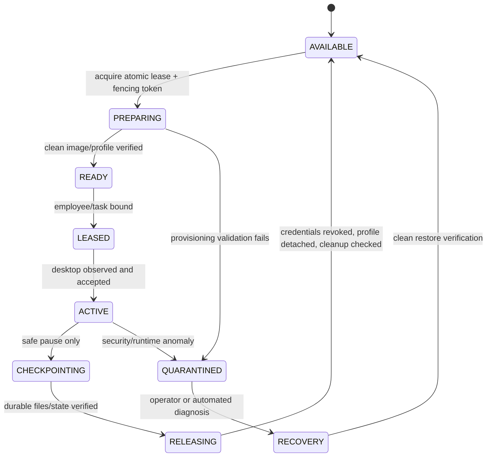

### 6.8 Memory and retrieval flow

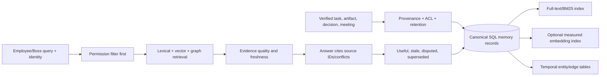

### 6.9 Model routing and Laya

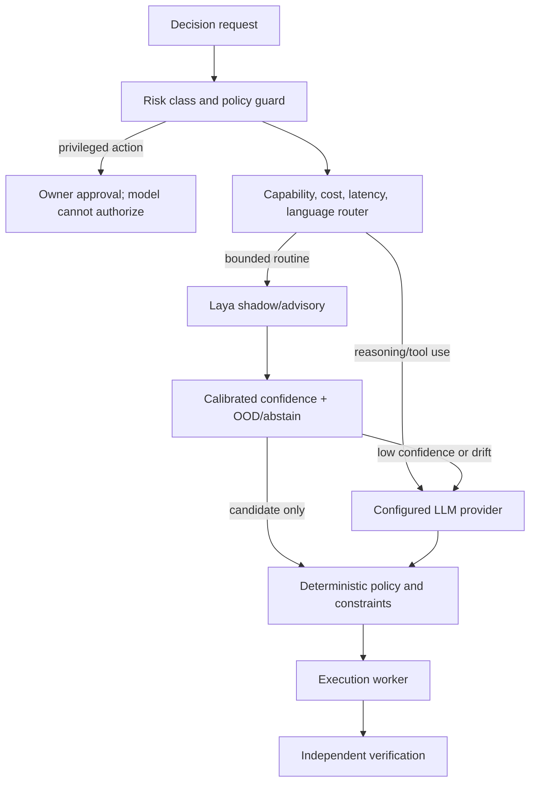

### 6.10 Learning and self-evolution loop

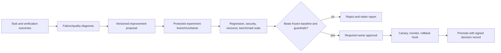

### 6.11 Governance and approval flow

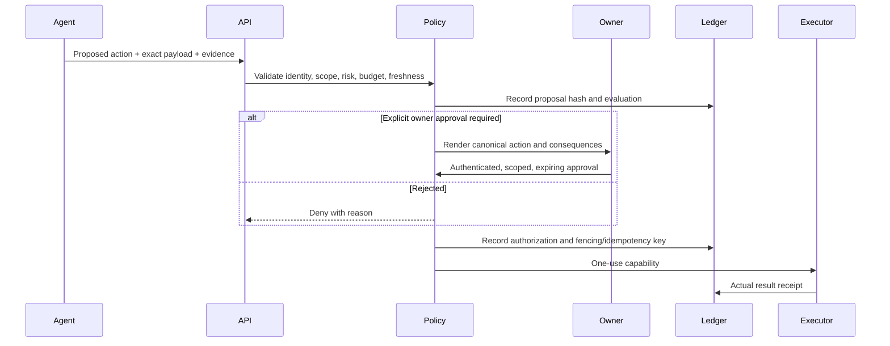

### 6.12 Security boundaries

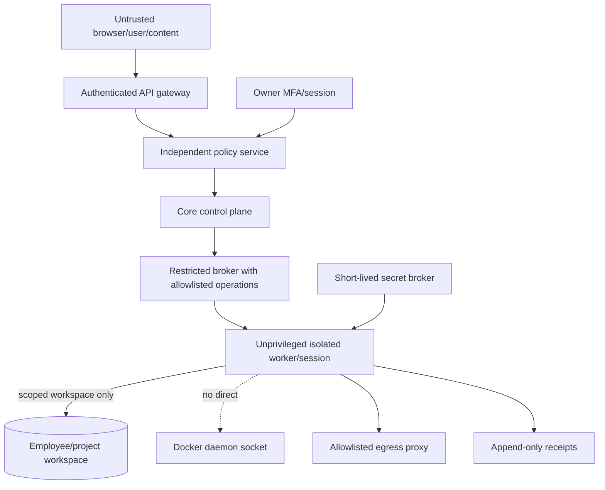

### 6.13 Deployment architecture

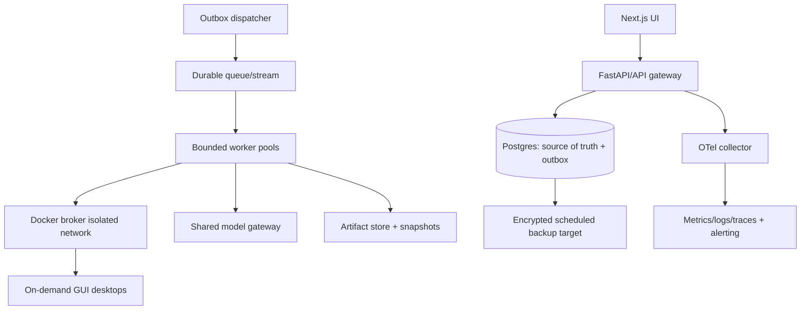

Profile A uses on-demand GUI slots with strict measured admission and bounded headless work. Profile B changes resource budgets/pool configuration after tests; it does not prescribe a number of sessions.

### 6.14 Failure recovery architecture

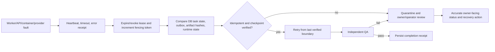

### 6.15 Data architecture and entity lifecycle

Canonical control-plane records live in one transactional relational store. Large artifacts live in a content-addressed file/object store; indexes and dashboards are derived and rebuildable. Sensitive content gets an explicit ACL and retention class. Do not put GUI screenshots, embeddings, model weights or full prompt histories into task rows.

| Entity | Owner and relationship | Lifecycle/storage | Retention and integrity |
|---|---|---|---|
| Employee | Company identity; belongs to department memberships; has skill grants, permissions and memory scopes | Persistent DB row, separate from any container/session | Retain employment history; suspension/retirement are state transitions, not deletion. |
| Department / team membership | Company; memberships have effective dates and role | Normalized DB rows, not a free-form-only label | Preserve prior assignment and authorization decisions. |
| Skill / certification | Employee capability claim linked to benchmark and task receipts | DB claim plus immutable evidence/artifact reference | Unverified by default; certificate expires or is revoked with reason. |
| Project / task / dependency | Project owns DAG; task references employee identity (not session) | DB rows with optimistic version; attempt rows append-only | Preserve each attempt and state transition. Hard delete only under retention policy. |
| Execution contract | Task attempt and policy decision | Immutable versioned JSON/schema in DB, hash in worker request | Retain with every attempt and approval. |
| Workspace | Employee/project owner and ACL, independent of sessions | Persistent volume/object store; path abstracted by storage ID | Version/checksum, quota, retention and restore receipt. |
| Execution session / lease | Task attempt + employee + slot + fencing token | Durable session/lease rows; runtime is ephemeral | Lease expires/revokes; retain audit metadata, not expired credentials. |
| Checkpoint | Attempt/session and artifact references | Versioned DB metadata + durable files; no asserted live-process snapshot | Keep only verified safe boundaries under retention class; checksum. |
| Artifact | Task attempt and project | Immutable content-addressed blob with DB metadata | Hash, media type, creator, source, scan result, version, ACL, retention. |
| Memory record / graph entity and edge | Owner scope (company, department, project, employee) and evidence provenance | SQL canonical record; FTS/vector/graph indexes derived | Valid-time, superseded/disputed status, retention/deletion tombstone. |
| Meeting / message / action item | Project/department, participant employee IDs and task links | DB plus outbox events | Minutes cite source receipts; messages have ACL and retention. |
| Decision / approval / vote | Proposal, authenticated actor and exact payload hash | Append-only DB ledger plus external signed checkpoint | Approval expiry, scope, single-use ID and outcome. |
| Experiment / model evaluation | Proposal, code/model/config revision, frozen benchmark | DB metadata + versioned artifact bundle | Preserve baseline/data hash, environment, raw scores and decision. |
| Audit / cost / telemetry link | Actor/service identity, correlation and task IDs | Audit DB + external sink; cost row is source for caps | Tamper-evident chain/checkpoint; financial records retain per owner policy. |

Relationship sketch: `Employee 1—N SkillEvidence`, `Employee 1—N Workspace`, `Employee 1—N TaskAssignment`, `Task 1—N Attempt`, `Attempt 1—N Session/Checkpoint/Artifact/VerificationReceipt`, `Project 1—N Task`, `Task N—N TaskDependency`, `Meeting N—N Employee`, `Approval 1—1 exact proposed payload`, `Memory N—N source artifacts/entities` through provenance tables. This deliberately keeps session state out of employee identity and prevents a task from being considered verified just because it has an artifact row.

### 6.16 API and event contracts

The following are **target contracts**, not claims that these endpoints/events currently exist. Keep existing routes backward-compatible with additive response fields during migration; deprecate old state mutation endpoints only after clients are migrated.

| API boundary | Target request/result | Owner and failure semantics |
|---|---|---|
| `POST /v1/objectives` | objective, constraints, requested modes, budget ceiling, project metadata → project ID + planning status | Boss owns plan; 401/403 unauthenticated/unauthorized, 409 idempotency conflict, 422 invalid constraints. Does not auto-hire or mark a task running. |
| `GET /v1/projects/{id}` / `GET /v1/tasks/{id}` | canonical state, version, current blocker, evidence links | Read model checks requester ACL; includes freshness timestamp and no synthetic defaults. |
| `POST /v1/projects/{id}/plan:approve` | plan version/hash, explicit approvals, resource/budget envelope | Policy service owns decision; 409 if plan changed, 403 policy denial, 202 if owner decision pending. |
| `POST /v1/employees` | role/capability need, approval reference, identity policy | Workforce service creates one persistent identity only after policy; no implicit roster bootstrap. |
| `POST /v1/tasks/{id}/attempts` | execution contract hash, worker identity, idempotency key → attempt ID + fencing token | Workflow service claims atomically; 409 if active lease/version mismatch, 429 if resource admission denied/queued. |
| `POST /v1/attempts/{id}/events` | typed event with sequence, token and provenance | Current lease required; reject stale fencing token or duplicate conflicting sequence. |
| `POST /v1/attempts/{id}/artifacts` | artifact metadata, hash, content reference and scan receipt | Artifact service verifies bytes/hash/ACL; same idempotency key returns prior artifact. |
| `POST /v1/attempts/{id}/verification` | verifier identity, rubric version, test/runtime evidence | Verifier owns acceptance and is independent of assignee; cannot accept missing/failed evidence. |
| `POST /v1/approvals/{id}:decide` | owner identity, approve/deny, payload hash, expiry-bound signature | Policy service; invalid/stale/already-used approval rejected and audited. |
| `GET /v1/events?after={cursor}` | authorized ordered event stream or SSE; cursor is durable sequence | API projection from outbox; reconnect replays; no direct UI polling worker-local memory. |

Event envelope: `event_id`, `event_type`, `schema_version`, `occurred_at`, `recorded_at`, `aggregate_type/id/version`, `actor_type/id`, `correlation_id`, `causation_id`, optional `project_id/task_id/attempt_id/employee_id/session_id`, `idempotency_key`, `classification`, `payload`, `evidence_refs`. Outbox insert commits in the same DB transaction as the state transition; a dispatcher may deliver more than once, consumers deduplicate by `event_id` and enforce aggregate version.

| Event | Emitted after | Consumer behavior |
|---|---|---|
| `objective.accepted` / `plan.proposed` | request and plan persisted | Owner UI shows planning; no work execution before policy approval. |
| `approval.requested` / `approval.decided` | signed proposal and decision persisted | Workflow remains blocked until valid decision; duplicate decisions are rejected. |
| `employee.recruited` / `employee.status_changed` | identity transaction committed | UI and workforce projections update from real employee ID; no fictional fallback. |
| `task.ready` / `task.leased` / `task.started` | DAG prerequisite and lease transaction | Router starts one attempt with contract and fencing token. |
| `attempt.checkpointed` / `attempt.failed` / `attempt.completed` | verified checkpoint or worker receipt persisted | Retry policy reconciles side effects before replay. |
| `artifact.created` / `verification.completed` | artifact hash or verifier receipt persisted | Task transitions only according to verification policy. |
| `session.quarantined` / `session.released` | runtime audit and cleanup record persisted | Prevent reuse until quarantine is cleared and profile isolation is checked. |
| `meeting.started` / `message.sent` / `action_item.created` | actual meeting/message/action persisted | Dashboard animates/updates only from these actual events. |
| `resource.pressure_changed` / `model.provider_health_changed` | telemetry threshold crossed | Admission/fallback changes with explicit owner-visible status. |

## 7. Execution modes and task routing

| Mode | Choose when | Boundary and resources | Verification / recovery |
|---|---|---|---|
| GUI | User-visible application state or GUI-only restriction is essential | One leased desktop; raw screenshot observation and pixel input only under strict contract; no DOM/a11y/API shortcuts | Before/after screenshots, action trajectory, visible app state, output file checksum; safe checkpoint only after observable stable state. |
| Terminal/code | Build, test, file transformation, programming and debugging | Ephemeral restricted process/container; per-task CPU/RAM/PID/disk/timeout; workspace read/write scope | Reproducible command, exit code, tests, artifact diff/checksum, separate reviewer. |
| Browser research | Public web lookup, source comparison and evidence synthesis | Isolated browser or controlled browser tool; outbound allowlist and source provenance | Record URL/title/time and extracted claims; cross-check primary sources; cite exact supporting sources. |
| Hybrid | Task explicitly needs GUI and CLI/code/browser/API in one trajectory | Contract lists allowed interfaces and handoff artifacts; one shared task ID/checkpoint, separate capability per interface | Unified event trace plus artifacts and shortcut detectors; WeaveBench-style trajectory-aware evaluation. |
| Approved API | Structured service action is safer and more reliable than GUI | Narrow OAuth/service scopes, owner-approved connector, rate/cost limits; no ambient credentials | API response + downstream state re-read; idempotency key and audit receipt. |
| Specialized | Document/media/data/science workflows require domain-specific tool | Separate bounded worker image and allowlisted packages/data | Domain validation (rendered pages, schema, numeric checks, application-native export) and independent acceptance. |

The task contract is persisted and signed/hashed with the plan. Broker rejects unlisted tools at runtime. Retries reuse stable idempotency keys for side effects; uncertain side effects stop for reconciliation instead of blind replay.

## 8. Desktop pool and resource architecture

### 8.1 Three lifecycles

1. **Employee identity:** DB row, role, memberships, permission grants, verified skills, memory ACLs, performance and lifecycle. Never tied to a container ID.
2. **Workspace:** durable employee-owned workspace/profile references and project artifacts, versioned and ACL-checked. Employee-private profile is not mounted for another employee.
3. **Session:** ephemeral container, VNC process, temp overlay, network capability, task lease and fencing token. Teardown revokes credentials, verifies profile detach, scrubs temp overlay and returns a slot.

### 8.2 Capacity admission

Keep “four GUI slots maximum” as the **initial policy ceiling**, not a claim that four concurrent desktops fit. Measure idle and task-active high-water/P95 for host, API/DB, Redis/queue, Laya/other inference and each task class. Effective capacity is the minimum permitted by (a) configured ceiling, (b) RAM budget after host/service safety reserve divided by task-class P95 memory, and (c) CPU budget after reserve divided by P95 CPU demand. Include browser and display spikes and concurrent model loading. Queue work if admission would cross reserve; do not evict unsafe/unsaved sessions.

The source currently has conflicting settings: global config/resource YAML allow ten employees and 4 GB each; desktop profile sets four slots with 2 GB each; 32 GB/64 GB profiles hardcode 8/16 slots and host CPU counts. No benchmark justifies these numbers. The 64 GB profile must be calibrated, not accepted as capacity.

### 8.3 Lease/checkpoint contract

Lease row includes `lease_id`, monotonic fencing token, employee/task/session IDs, expiry, heartbeat, image digest, resource reservation, mode/tools/network policy, credential handles and checkpoint. All actions require current token; broker denies stale token. Lease claim/release is transactional. Checkpoints contain verified file/artifact references, workflow step, pending side effects, app identity/version, screen observation hash, safe-to-resume declaration and next action. Screen hash is diagnostic only; resume always observes actual state and checks idempotency.

### 8.4 Resource pools

Maintain separate bounded admission classes for GUI, headless code/research, hybrid and shared inference. They share a host budget but not one global queue. A task with no display need does not consume a GUI slot. Use on-demand desktops by default. Warm profiles are an experiment only if measured P95 latency saved outweighs retained RAM. Docker pause is not RAM reclamation. Do not depend on experimental container checkpoint/restore.

## 9. Boss and workforce architecture

Boss modules: objective/constraint interpreter; strategic portfolio planner; operational DAG planner; capability/workload/resource assignment; risk/cost evaluator; evidence monitor; recovery coordinator; decision log; executive reporter; learning proposal generator. Fast System 1 can rank bounded candidates but cannot make irreversible actions or verify its own output. Owner authority/policy remains outside Boss reasoning.

Recruitment requires a justified role gap, owner/policy-allowed action, persistent identity and permission set. Do not auto-populate a roster. Departments need first-class records and membership history; a free-form employee `department` string does not support department lifecycle. Skill levels remain unverified until independently scored task receipts are accepted. Employee permissions are not inferred from self-reported role/skill. Availability and employment state must survive session teardown; task cancellation must not terminate the employee.

The existing `EmployeeFactory` is reusable for record creation, but automatic bootstrap from `api/routes/boss.py` must be removed before any real production use. Generated personas and names should only be instantiated as real employee identities after an explicit recruitment decision; demo fixtures remain separate test data.

## 10. Memory, RAG, GraphRAG and knowledge architecture

Use Postgres as canonical memory metadata and state; store content as immutable artifact/blob references with checksums. Memory record schema: `memory_id`, owner/scope, layer/category, source artifact/event, created/valid/superseded timestamps, ACL, confidence, verification state, retention class, content hash, index versions and provenance. Indexes are derived/rebuildable. Delete/update is an audited tombstone and reindex operation; private memories require explicit sharing.

Build retrieval in stages: Postgres FTS/BM25 + metadata filters; then a labeled evaluation set and optional dense vectors; fusion/reranking only if benchmark lifts recall/grounded precision enough to justify RAM/latency. Agentic retrieval gets fixed max rounds, timeout, token budget and source citations. Add temporal graph tables (entity, edge, source, valid interval, ACL, confidence, verification/dispute) in SQL. Graph expansion obeys ACL at each hop. No separate graph DB until query volume, graph size or query-latency data justifies it.

Current `six_tier_store.py` is primarily in-memory; `temporal_graph.py` stores dicts plus NetworkX; `vector_store.py` creates deterministic n-gram hash vectors and optional default Chroma client. These structures are useful interfaces/prototypes, not durable organizational memory or semantic GraphRAG. In the near term, do not introduce a second graph/vector database.

## 11. Laya and MoE architecture

| Function | Mechanism | Guardrail |
|---|---|---|
| Within-model sparse MoE | Chosen internally by a model architecture; unrelated to ANCOS employee selection | Do not label organizational employee selection as neural MoE. No custom sparse model training is justified now. |
| Organizational expert selection | Match task capability, verified evidence, workload, availability, permission and mode | Use a deterministic explainable baseline; log candidate set/reason; train a router only after outcome data exists. |
| Provider/model routing | Rules first, then measured router for cost/quality | Evaluate held-out ANCOS tasks, provider latency/outage/cost, calibration and abstention; provider models can change. |
| Laya System 1 | Typed choice/score/yes-no/novelty candidates in shadow/advisory | Pin revision/hash; calibrate per domain/language; out-of-distribution/low-confidence abstains; fallback explicitly says heuristic. |
| Deep reasoning | Real configured LLM for planning and multi-step analysis | Budget caps, circuit breaker, bounded context, tool allowlist and evidence trace. It does not approve policy exceptions or certify success. |

The test run observed seven warnings from `laya_adapter.py` because invalid temperature calibration values were clamped. Treat affected confidence as **uncalibrated**, regardless of apparent model name. Freeze a labeled holdout before recalibration and compare expected calibration error, Brier score, selective accuracy/risk, per-language errors and latency. Preserve current checkpoint hash test. The current “DeepBrain” lexical fallback and 35 ms latency must be renamed and excluded from LLM metrics until replaced by real model calls.

## 12. Learning and self-evolution architecture

Learning lifecycle: verified receipt ingestion → deduplicated failure taxonomy → causal hypothesis with linked evidence → change proposal and risk class → isolated branch/worker → frozen baseline and representative holdout → regression/security/resource/cost tests → independent evaluation → approval if policy requires → canary → automatic rollback trigger → signed promotion record. Unsuccessful experiments are retained as results but never deployed.

The current prompt optimizer's score values are constants and should be treated as fixture/demo output, not improvement measurement. A test passing on those constants must never report improvement. Prefer opt-in operator-triggered experiments; no recursive self-modification of policy, auth, broker or release code. Learning memory stores a verified procedure only after independent QA.

## 13. Governance and security architecture

### 13.1 Risk-based approval matrix

| Action class | Default authority | Required checks |
|---|---|---|
| Read company-scoped records | Authenticated owner/authorized service identity | Scope/ACL, audit, rate limits. |
| Create project/task or recruit | Boss proposal under explicit owner policy | Budget/resource feasibility, no default fake employee bootstrap; approval threshold configurable. |
| External communication, purchase/spend, publish | Owner approval by default | Exact recipient/payload/amount, destination allowlist, current approval and single-use idempotency token. |
| Deploy, credential/permission change, infra/security policy | Explicit owner approval plus independent reviewer | Signed diff, test/security receipts, backup, rollback/canary. |
| Delete data, terminate employee/session, irreversible operation | Owner approval unless narrow emergency policy | Scope, retention/legal hold, backup/restore proof, emergency stop check. |
| Emergency stop | Owner, authenticated emergency path | Immediate global dispatch stop, revoke worker leases, preserve evidence; resume requires explicit action. |

### 13.2 Threat model

| Threat | Attack surface | Control and acceptance proof |
|---|---|---|
| Direct/indirect prompt injection | User, web page, repository, email, tool output, agent peer | Mark untrusted evidence; model output cannot change policy/tools; red-team injection tests show denied side effects. |
| Unauthorized API/action | Unauthenticated REST routes, permissive CORS, default signing secret | Owner auth/MFA for sensitive actions, service identity, RBAC/ABAC, CSRF/origin rules, secret startup validation; prove anonymous reads/writes rejected. |
| Docker control-plane abuse | Core API to socket proxy; proxy POST/volume/network permissions | Narrow broker API, no generic socket/API exposure to model/employee; allowlisted endpoint+args; proxy/API negative tests and live daemon audit. |
| Workspace/profile cross-access | Bind mounts, stale slots, employee IDs/paths | Canonical path resolution, symlink/Windows drive tests, per-employee ACL, volume mount audit, lease fencing; two-worker isolation test. |
| Credential exfiltration | Env vars, logs, shared profiles, tool output | Short-lived secret broker, no ambient credentials in desktop image, redact logs/artifacts, rotate on lease release; canary secret exfil test. |
| Malicious dependency/model/artifact | PyPI/HF/Docker image | Lockfile, pinned hashes/digests, SBOM/license scan, signature verification, model provenance, image rebuild test. |
| RAG data leak/poisoning | Vector/graph memory and metadata | ACL before retrieval and per-hop; provenance/confidence, quarantine untrusted content, retrieval authorization tests. |
| Denial/cost exhaustion | Long loops, screenshots, retries, indexing, model calls | Per-task/project/month ceilings, queue/admission control, total deadlines and circuit breakers; stress/cost fault-injection. |
| Audit tampering | DB-only hash chain and logs | Append-only signed/checkpointed external chain; actor authentication; restart/alter/reorder test, backup verification. |
| Approval spoofing/UI injection | Attacker-controlled content rendered in approval | Canonical structured action summary independent of model text, safe HTML escaping, approval binds exact payload hash and expires. |

Immediate finding: API setup in `api/main.py` has `allow_origins=["*"]`, credentials enabled, and no auth middleware/dependencies found on core routes; `config.py` contains a known default `SECRET_KEY`. Do not expose this API outside a trusted local development environment until fixed and penetration-tested.

## 14. Projects, QA, meetings and communication

Projects persist objective, execution plan, tasks, dependencies, results and artifacts. Keep this model. Add contract/version fields and separate task state from verification state: `planned → ready → leased → running → submitted → verifying → verified | rejected`; task can be complete only when policy's evidence threshold is met. Preserve immutable attempt records and do not overwrite failure receipts on retry.

Use branch-per-contribution for code changes, signed artifact/checksum registry, typed API schemas generated from OpenAPI, and independent integration/security review. Meeting participants must come from current task ownership/dependencies and actual availability; meeting report fields cite artifacts/events. Asynchronous updates win unless a decision requires synchronous debate. Action items are normal tasks with owner and deadlines; meeting text alone does not complete them.

Current repositories include meeting, action-item, proposal and audit models/routes, but an API task assignment currently sets status to `RUNNING` and sends an in-process/Redis message without a durable worker receipt. No WebSocket route was found; any dashboard “live” behavior should be described as polling unless event streaming is implemented. Build an event stream later from the outbox, not from volatile worker-local state.

## 15. Dashboard architecture

Retain Next.js and current independent Canvas modules; avoid a renderer rewrite. World state should be a read-only projection of canonical employee/task/session/meeting/message events. Character IDs always map to persistent employee records, state derives from last real event plus staleness policy, and disconnected data has a visible disconnected state. Employees and conversations never exist only in background image pixels. Workstation inspection resolves to a real session/lease; VNC uses an authenticated short-lived token and never exposes raw host ports to anonymous browser clients.

Separate static room art, furniture, independent pixel sprites and interaction overlays. Character animation can use frame-based pixel sprite sheets; each motion state is keyed by activity event/waypoint. Pan/zoom/selection is presentation only. No fake uptime/health/employee score. UI states: loading, empty, API unavailable/stale, idle, active task, blocked, approval pending, session disconnected, recovering, verified. Dashboard acceptance uses seeded isolated test data and compares the rendered entity/status list to API event snapshots.

## 16. Observability and reliability

Use a common trace/correlation ID across owner request, plan, task, execution attempt, session lease, model call, approval, artifact and verifier. Emit structured events for state transitions only after DB commit. Maintain metrics for queue wait, task duration, attempt/retry count, result/verification status, tool call latency, provider spend/latency/error, resource high-water, slot acquisition/release, stale lease and retrieval evidence quality. Do not log prompts/secrets wholesale.

Every state transition has idempotency key, version/optimistic concurrency check, event/outbox record and explicit retry class. Retry transient provider/network errors with capped jitter; do not retry policy denials or validation failures. Duplicate event handling is idempotent. Poison events go to a dead-letter table/queue and owner-facing blocker. Reconcile DB tasks with expired leases and actual container state at startup. Alert on DB restore failure, audit chain break, budget saturation, queue-age SLO breach, host memory reserve breach and repeated provider outage.

Current custom logging/metrics can remain behind a common interface. OTel spans/metrics/logs are a standard export shape, not a requirement to buy a monitoring vendor now.

## 17. Hardware profiles and scaling

**Profile A (~16 GB):** configure at most four desktop slots; admit zero to four based on current headroom and measured per-class P95. Run one shared Laya process only if its measured RSS does not threaten reserve; otherwise route System 1 to bounded external/CPU service or deterministic rules and label it. Queue indexing and background research. Keep core DB, API, GUI and inference under one overall budget.

**Profile B (~64 GB):** same modules, larger configurable budgets. Determine count only after running concurrent desktop and model load tests and measuring CPU, RAM, GPU/VRAM, storage IOPS, browser/app mix and workload duration. No fixed 16-slot target.

For both profiles, benchmark 1, 2, 3, 4 slots (A maximum) with idle and representative active browser/IDE/GUI tasks; record median, P95 and peak, OOMs, latency and CPU. Future B tests progressively increase concurrency until threshold/quality failures, then set operational cap below the saturation point. Degrade by pausing new admissions, keeping safe active sessions, reducing background indexing, switching model tiers only within policy, and reporting queue estimates rather than killing sessions.

## 18. Gap register

| ID / severity | Subsystem and evidence | Impact | Proposed solution | Acceptance criteria |
|---|---|---|---|---|
| G-01 **P0** | Task execution: `tasks/scheduler.py` default worker returns success after 10 ms; objective endpoint only plans/assigns. | False completion and autonomous-company claims. | Remove success default in production; require registered executor; persist attempt/output/exit receipt; fail closed when no worker. | No task can become verified/completed without real worker and verifier receipts; missing worker stays queued/blocked. |
| G-02 **P0** | Docker manager returns simulated command output and exit 0 on no daemon/exec failure. | Fake command/test result can be used as ground truth. | Return typed unavailable error; mark runtime `SIMULATED` only in explicitly isolated test adapter; forbid it in production verifier. | Fault-injected daemon failure yields nonzero/unavailable result and zero verified completion. |
| G-03 **P0** | `api/routes/boss.py` calls `bootstrap_initial_workforce()` if roster empty; factory names Alex/Maya. | Violates no-prepopulation invariant and pollutes owner company. | Empty company stays empty; recruitment only from explicit plan and policy. Remove demo workforce from production path. | Fresh DB objective shows zero employees until approved recruitment; tests assert no fixed IDs/names. |
| G-04 **P0** | `api/main.py` permissive CORS; no auth guard found; `config.py` has default secret. | Unauthenticated control-plane, employee/task/security actions exposed. | Add owner identity/session auth, service identities, authorization on every mutating route, secure config validation, CSRF/origin limits and secrets manager. | Anonymous access denied; role matrix tests; production startup fails with default secret; security review passes. |
| G-05 **P0** | Compose Docker socket proxy enables broad `POST`, VOLUMES, NETWORKS and IMAGES; core has proxy reachability. | API compromise may become host/container control. | Remove generic socket API from core; isolate dedicated broker with narrow typed operations and owner policy. Restrict image registry/digests/networks/mount paths. | Adversarial API requests cannot create arbitrary mounts, privileged/container, image or network; live Docker isolation test passes. |
| G-06 **P1** | Task leases, slots, queues, active workers process-local; Redis Pub/Sub selected in-memory by API deps; no durable queue worker. | Restart loses assignments, duplicate or orphan work; multi-worker race. | DB task state + transactional outbox, atomic lease/fencing, worker process/queue; compare Temporal pilot. | Kill API/worker mid-task; exactly one current fencing token, recover/reconcile without lost or false completed task. |
| G-07 **P1** | Employee/container one-to-one-ish record, workspace path and session lifecycle mixed; checkpoint is JSON with no verified app state. | Session release may destroy work or resume stale state. | Separate identity/workspace/session data and explicit resume contract; artifact snapshot + actual screen validation. | Employee persists across clean session rebuild and observes real app before continuing. |
| G-08 **P1** | `db/engine.py` uses `create_all`; no migrations found despite Alembic dependency. | Schema changes cannot be safely rolled forward/back or deployed. | Set up Alembic baseline and staged migrations; schema compatibility/rollback. | Upgrade from previous populated DB, rollback supported changes, backup restore to supported revision. |
| G-09 **P1** | Memory/graph/queue are volatile; hash embeddings and optional default Chroma client. | Restart loses memory; recall can be lexical, privacy stale or incomplete. | Canonical persisted records, FTS baseline, derived indexes, SQL graph, ACL first. | Retrieval survives restart/rebuild, source provenance and ACL pass cross-employee tests. |
| G-10 **P1** | Laya calibration warnings and lexical “DeepBrain” fallback with synthetic latency. | Confidence and routing/latency reports misleading. | Recalibrate on held-out ANCOS data; rename heuristic and do not report as model; wire real reasoning handler. | ECE/Brier/selective risk within signed thresholds; fallback attribution explicit; no simulated latency. |
| G-11 **P1** | Meta-learning outputs fixed 0.68/0.92 quality and improvement %. | Fake learning claim can auto-promote ineffective change. | Baseline and holdout runner with artifact-specific score; no hardcoded uplift; human gate. | Failed/non-improving candidate rejected; regression rolls back and results auditable. |
| G-12 **P1** | Approval objects/kill switch exist but no API auth and gate invocation coverage is unproven. | Approval record can be forged or bypassed; sensitive routes exposed. | Bind approvals to actor, payload hash, expiry, scope and one-time capability; enforce outside model. | Every sensitive-action route has deny test without current owner approval and audit receipt. |
| G-13 **P1** | GUI modules rely on mock/synthetic frame support; no live VNC host. | Passing tests do not prove pixel observation/action or runtime screenshots. | Separate hardware-free unit suite from live desktop acceptance; actual screenshot and actuator integration. | Live GUI task records actual before/after screenshot and action receipts with visible state verification. |
| G-14 **P1** | 16/32/64 profiles hardcode desktop count; resource config conflict; no load test. | OOM and host instability risk. | Workload-class P95 admission controller; one to four desktop tests; no assumed future count. | Thresholds are measured, headroom maintained and queue admission respects pressure. |
| G-15 **P1** | Backup manifest/package exists; no encryption/off-host retention; restore/archive security not proven. | Single host loss, tampering, sensitive data exposure or unsafe restore. | Encrypt, external immutable destination, key lifecycle, signed manifests, archive path validation, scheduled clean-room restore. | Restore checksum, SQLite/Postgres integrity, ACL, artifacts and RPO/RTO meet owner target. |
| G-16 **P2** | Meetings, messages, events are partly DB-backed but live stream not wired; no WebSocket route found. | Dashboard may display stale/invented activity or miss events. | Outbox-backed SSE/WebSocket projection and explicit freshness/disconnected state. | UI event projection agrees with DB sequence; reconnect catches up without duplicate speech/progress. |
| G-17 **P2** | Dashboard includes custom game layer but backend telemetry and employee sessions not live-tested. | Product impression may outrun system evidence. | Bind each visual state to backend event; add truth/freshness contracts and empty state. | Seeded E2E snapshot tests and live event test; empty/disconnected states contain no fictional employees. |
| G-18 **P2** | Custom metrics/logging no unified trace/export/alerting found. | Cannot reconstruct cross-service failure/cost/resource story. | Add trace ID propagation and OTel export, retain structured audit. | One owner request trace joins plan/task/model/session/artifact/verifier and alert fault-injection. |
| G-19 **P2** | Department is plain employee string; no workspace/checkpoint/lease/experiment tables. | Organizational/operational lifecycle limits and poor auditability. | Add minimal normalized rows only as roadmapped, with compatibility migration. | Department create/member history and independent session/task restart tests. |
| G-20 **P2** | 4× benchmark helpers exist but no certified workload/human trial evidence. | Speed claim unsupported and quality may be traded away. | Certified task suite with equivalent environment and full elapsed time. | Multiple matched trials; publish completion/quality/time/cost/intervention/resource and confidence interval. |

## 19. Architecture decisions

| ID | Decision | Alternatives and trade-off | Evidence/status |
|---|---|---|---|
| ADR-01 | No broad rewrite; keep FastAPI, SQLAlchemy, existing model/service boundaries. | Rewrite creates migration risk and duplicates working logic. | Verified project structure/tests support reuse; path-level realism remains needed. |
| ADR-02 | No synthetic success in production paths. | Convenience simulator is easy for demos but contaminates evidence. | Current default worker and Docker fallback return success-shaped results. Test-only adapter must be visibly isolated. |
| ADR-03 | Empty roster means zero employees; recruitment is explicit and auditable. | Automatic named bootstrap shortens demo but contradicts production identity invariants. | Current Boss endpoint bootstraps Alex/Maya. Remove in first implementation phase. |
| ADR-04 | PostgreSQL is production canonical store; SQLite remains dev/test option pending migration proof. | SQLite simpler; one writer and local-only WAL constrain multiworker architecture. | Existing asyncpg/alembic dependencies and DB abstractions make migration tractable. |
| ADR-05 | Durable DB outbox/queue first; Redis Pub/Sub only ephemeral fanout. | Could adopt Temporal immediately; adds durability but operational service footprint. | Current in-memory preference and volatile pubsub; perform Temporal POC before decision. |
| ADR-06 | Persist task/session lease with fencing and idempotency; workspace is not session. | Container checkpoint/restore cannot be relied on (experimental and platform constrained). | Existing pool/checkpoint prototypes show bounded code reuse but require state persistence. |
| ADR-07 | SQL FTS + relational temporal graph first; vector index is derived optional. | Chroma/Graph DB can add scale features, but current corpus/latency are unmeasured. | Existing vector/graph code is in-memory and deterministic-hash dense retrieval. |
| ADR-08 | Laya advisory-only until calibrated; no model authorizes actions. | Fast model may reduce latency/cost but calibration warning and out-of-domain risk. | Actual local inference verified; seven runtime warnings observed. |
| ADR-09 | Dashboard is read-only event projection; retain Canvas renderer. | Replacing renderer does not fix source-of-truth/fake activity. | Existing independently rendered modules are reusable; backend unavailable. |
| ADR-10 | No fixed 64 GB slot count and no 4× speed claim before matched benchmark. | Convenient numbers are not measured capacity/performance. | Current hardware profile hardcodes 16 slots; no resource trials were run. |

Open owner decisions: production deployment scope (local single-user vs remote); minimum API auth/MFA; acceptable external-provider data policy; spend approval thresholds; backup target/retention and RPO/RTO; whether headless workers may run outside desktops; hybrid-task shortcuts allowed; costs/license fit for Temporal/Kasm; workforce naming policy for generated AI identities; test corpus that can be used for performance certification.

## 20. Dependency-aware implementation roadmap

No code implementation has begun for this audit. The sequence below is a proposal, and each phase has a rollback point.

| Phase | Objective / reuse | Changes and dependencies | DoD / tests | Rollback |
|---|---|---|---|---|
| A. Trust baseline | Preserve current task/models; source inventory, existing tests | Feature flag and config separation for test simulators; fail-closed task status; remove startup bootstrap in production; label runtime status | Empty company test; no-Docker false success test; full 370 baseline remains green | Re-enable only isolated test adapter; DB untouched. |
| B. Security control plane | Existing security gate, approval and audit classes | Auth/session identity, secret startup validation, route-level auth, CORS, approval payload binding, Docker proxy threat boundary; informed by threat model | Anonymous/role/CSRF/sensitive-action and broker negative tests; manual security review | Local-only dev flag; retain old API only on loopback during transition. |
| C. Durable schema and events | Existing repositories/entities, SQLite dev mode | Alembic baseline; Postgres target; event outbox/attempt/lease/session/workspace/artifact schemas; data migration tools | Migration from current SQLite fixture/database; rollback and restore tests; idempotent event dispatch | Snapshot DB; staged dual-read only during controlled cutover. |
| D. Worker and execution contract | Existing DAG, TaskStateMachine, Docker broker, GUI control | Worker service, task execution contract, durable queue, idempotency, event receipts; decide outbox vs Temporal after POC | Two dependent real tasks; restart/fault test; prohibited mode denied | Stop workers, keep tasks queued, revert worker image; no task row deletion. |
| E. Desktop pool | Existing resource scheduler, VNC and checkpoint classes | Durable leases/fencing; separate employee workspace; live provision/observe/release; quarantine; resource profiling | One then 1–4 concurrent sessions; cross-employee profile and stale-token tests | Cap admission at 0; retain workspaces/checkpoints. |
| F. Independent QA and artifacts | Existing verifier/artifact/result models | Mandatory evidence states; independent test/security worker; signed receipts and append-only state history | No artifact/no tests cannot complete; adversarial proof test; rollback rejected artifacts | Preserve attempt records; downgrade to review/blocked, never erase. |
| G. Meetings and live dashboard | Existing meeting routes/models and Canvas UI | Outbox event stream, state projection, real VNC auth; empty/disconnected/blocked/recovery UIs | Seeded E2E and real event test; dashboard sequence matches DB | Return UI to polling/read-only; world art remains. |
| H. Memory and decision models | Existing hybrid retrieval, Laya and graph APIs | Durable ACL memory, FTS baseline, temporal graph persistence; labeled retrieval set; recalibrated Laya shadow | Restart/privacy/provenance tests; ECE/Brier/selective metrics; no model approval | Feature flag disable vector/Laya; source SQL records remain. |
| I. Controlled improvement | Existing method/tool/evolution records | Replace fixed scores with frozen baselines, branch isolation, security and resource suites, promotion gate | Negative experiment rejected, winning canary monitored, rollback auto-tested | Revert protected branch/config and preserve experiment evidence. |
| J. Scale/certify | Profiles, benchmark helpers | 16 GB profile and future measured hardware; certified OS benchmark subset, 4× human methodology | Reports reproduce from pinned images/data; owner approval on operational targets | Keep old configured cap and disable concurrency increase. |

## 21. Acceptance test matrix

| Scenario | Required automated/manual proof | Current state |
|---|---|---|
| 1 Dynamic recruitment | Fresh DB starts with zero employees; capability gap proposal, approved recruit, persistent ID/workspace, onboarding evidence and skill stays unverified until test. | Fails current Boss endpoint due named bootstrap. |
| 2 Multi-employee project | Plan DAG, dynamic assign, real worker artifact contributions, branch integration, QA/security and evidence report. | Plan/task tests exist; no production worker execution proven. |
| 3 Desktop contention | Submit > capacity, FIFO/priority fairness, bounded leases, no identity deletion, resource admission, no unsafe preemption. | In-memory scheduler tests; no daemon/load test. |
| 4 Employee resumption | End session, verify checkpoint/artifacts, release credentials, restart worker/API, new clean session/profile, observe current screen, resume non-idempotent-safe. | JSON checkpoint tests do not validate real app/session. |
| 5 Cross-mode task | Research + browser + code + GUI using explicit contract; trace tool calls; reject forbidden tool. | Modules exist separately; no full hybrid contract/E2E. |
| 6 Model outage | Provider timeouts/rate limit; capped retry, actual fallback identity/cost, preserve task state, no duplicate side effect. | Retry unit tests; live provider outage test unavailable. |
| 7 Memory reuse | Verified prior failure found with citations; stale/disputed excluded; private record denied to other employee. | Retrieval tests; restart durability/real permission boundary missing. |
| 8 Learning from failure | Failure has linked receipt, proposal, frozen baseline, isolated run; non-improvement discarded; winning result reproducible. | Current optimizer returns fixed score values. |
| 9 Safe self-evolution | Branch, reproducible tests, security gate, owner approval, canary, telemetry regression and automatic rollback. | Governance/evolution modules tested in isolation; full promotion path not proven. |
| 10 Company governance | Sensitive proposal payload hash, authenticated owner approval, deliberation, single use, action receipt and immutable audit. | Proposal/vote/ledger exists; authentication boundary missing. |
| 11 Real-time dashboard | Actual DB event drives sprite/activity/meeting/metrics; stale/disconnected state; no fictional entities or baked UI values. | Current dashboard code; no live API/worker event verification. |
| 12 Resource exhaustion | CPU/RAM pressure causes admission stop/queue, protects current safe work, reports resource facts, resumes only after headroom. | resource monitor unit tests; no stress run. |
| 13 Full recovery | Kill API/worker/session; fencing and reconciliation; DB and artifact restore; accurate status and no false success. | Backup and recovery unit tests; no process/Docker crash chaos test. |
| 14 Four-times speed | At least certified workflows; same inputs/app state/version, multiple human and ANCOS runs; full elapsed time, quality, cost, failures, intervention and resource. | No speedup certified. |

Test suite by evidence class: unit (pure rules); service integration (hermetic SQLAlchemy/in-memory SQLite fixtures and Redis substitutes); live component (pinned Postgres/Redis/Docker and local Laya); end-to-end (owner goal to independently verified artifact); security adversarial; resource stress; benchmark/certification; manual owner acceptance. The current **370 passed** is a hermetic suite result, not completion of this matrix.

## 22. Risks and unresolved research questions

| Rank | Risk / question | Why it matters | Closure action |
|---|---|---|---|
| Critical | Synthetic scheduler/command success | Directly corrupts task evidence and owner reports. | First code phase, gated tests, status/data migration if synthetic statuses persisted. |
| Critical | Missing API auth + default secret | Remote caller may control workforce/tasks/governance. | Security design and penetration review before network exposure. |
| Critical | Docker proxy breadth and daemon unavailable in this environment | Application compromise can become host compromise; actual runtime behavior is unknown. | Restrict broker and test on dedicated disposable Linux host. |
| High | SQLite + create_all production startup | Concurrent writer issues and schema drift/rollback risk. | Alembic baseline, DB selection, migration plan. |
| High | Session/workspace/checkpoint gaps | Stale GUI state and cross-identity data leakage. | Fenced persistent lease and clean-session resume experiment. |
| High | 16 GB host capacity unknown | Four desktops + model/API may starve host. | Measure P95/HWM; no concurrency guarantee until done. |
| High | Laya calibration and English support | Misrouting/confidence can harm decision quality, especially multilingual founder requests. | Label and calibrate Hindi/English domain dataset; abstain for unsupported distributions. |
| High | LLM/model and Redis license movement | Version tags and model assets have separate license/redistribution terms. | Pin images/weights/dependencies and record SBOM/model card/license snapshot. |
| Medium | Chroma/GraphRAG added before need | Increased memory/ops/cost without retrieval gain. | Benchmark and license review before adoption. |
| Medium | Graph extraction quality/ACL | Wrong edges and graph expansion can leak or mislead. | Provenance, review, correction/supersession, ACL-at-each-hop tests. |
| Medium | Benchmark contamination and shortcutting | Inflated score can mimic company capability. | Task holdout, trajectory-aware judge, no test-specific metrics, pinned environment. |
| Unresolved | Deployment mode, auth/MFA and tenant boundary | Changes data isolation and network architecture. | Owner chooses local-only first vs remote/multi-tenant. |
| Unresolved | Spend, retention, backup RPO/RTO | Affects budgets, external services and data governance. | Owner specifies monetary and recovery limits. |
| Unresolved | Generated identity naming policy | Need employee names but no fabricated prepopulation. | Decide whether system-generated names on explicit hire are acceptable and how they are labeled. |

## 23. Final owner approval checklist

Before implementation, owner should approve:

- [ ] This audit's top four P0 findings and the order: fail-closed execution, no bootstrap employees, API auth, narrow Docker broker.
- [ ] Whether production target is a single-owner local deployment first or remotely accessible service.
- [ ] Postgres production target with SQLite retained for development/tests, plus a migration and rollback window.
- [ ] Durable outbox/worker first and a bounded Temporal comparison before selecting a workflow engine.
- [ ] Desktop four-session ceiling as a temporary cap only; no fixed 64 GB capacity promise.
- [ ] Policy for generated employee names/personas on explicit recruitment, with empty roster default.
- [ ] External LLM/data handling, budget approval thresholds and model artifact licensing review.
- [ ] Backup encryption, off-host destination, retention, acceptable RPO/RTO and incident response ownership.
- [ ] Which certified workflows and human baseline cohort can be used for a future 4× speed evaluation.
- [ ] Whether Kasm/GraphRAG/vector serving is evaluated in small POCs or deferred until baseline metrics justify it.

**Implementation status:** the audit was the initial deliverable; the owner subsequently authorized implementation. The checklist records remaining decisions and acceptance evidence, not a stop condition. Continue the roadmap while preserving unresolved owner decisions as explicit deployment gates.

---

## Research sources (checked 2026-11-01)

### Primary benchmarks and papers

- [OSWorld official repository](https://github.com/xlang-ai/OSWorld) and [OSWorld paper](https://arxiv.org/abs/2404.07972)
- [OSWorld-V2 official releases](https://github.com/xlang-ai/OSWorld-V2/releases) — latest visible release `osworld-v2.1` at audit date; [OSWorld 2.0 paper](https://arxiv.org/abs/2606.29537)
- [OSWorld-Human paper](https://arxiv.org/abs/2506.16042)
- [DynamicGUIBench paper](https://arxiv.org/abs/2604.25380) and [author repository](https://github.com/Liu-arch/Benchmarking-and-Improving-GUI-Agents-in-High-Dynamic-Environments)
- [WindowsWorld paper](https://arxiv.org/abs/2604.27776) and [author repository](https://github.com/HITsz-TMG/WindowsWorld)
- [WeaveBench paper](https://arxiv.org/abs/2606.09426) and [project/repository](https://weavebench.github.io/)
- [MacAgentBench paper](https://arxiv.org/abs/2606.22557) and [author repository](https://github.com/JetAstra/MacAgentBench)
- [Switch Transformers (JMLR)](https://www.jmlr.org/beta/papers/v23/21-0998.html)
- [RouteLLM (ICLR 2025)](https://proceedings.iclr.cc/paper_files/paper/2025/hash/5503a7c69d48a2f86fc00b3dc09de686-Abstract-Conference.html)
- [LLMRouterBench (ACL Findings 2026)](https://aclanthology.org/2026.findings-acl.1881/)
- [AgenticRAG paper](https://arxiv.org/abs/2605.05538)

### Official technical documentation and project sources

- [Microsoft GraphRAG query overview](https://microsoft.github.io/graphrag/query/overview/) and [local search](https://microsoft.github.io/graphrag/query/local_search/)
- [From Local to Global: GraphRAG paper](https://arxiv.org/abs/2404.16130)
- [Laya official project site](https://laya.convaiinnovations.com/), [Laya GitHub SDK](https://github.com/NandhaKishorM/laya), [Hugging Face model card](https://huggingface.co/convaiinnovations/laya)
- [Docker resource constraints](https://docs.docker.com/engine/containers/resource_constraints), [rootless mode](https://docs.docker.com/engine/security/rootless/), [seccomp](https://docs.docker.com/engine/security/seccomp), [checkpoint CLI (experimental)](https://docs.docker.com/reference/cli/docker/checkpoint/)
- [SQLite WAL](https://www.sqlite.org/wal.html)
- [Temporal workflow execution](https://docs.temporal.io/workflow-execution), [task retry/idempotency](https://docs.temporal.io/tasks), [Python SDK license](https://github.com/temporalio/sdk-python/blob/main/LICENSE)
- [Kasm licensing](https://docs.kasm.com/docs/develop/reference/license), [Kasm persistent profile feature status](https://docs.kasm.com/docs/latest/reference/experimental-features/feature-index), [product lifecycle](https://docs.kasm.com/docs/latest/reference/product-lifecycle)
- [OWASP LLM Top 10 2025](https://owasp.org/www-project-top-10-for-large-language-model-applications/) and [Excessive Agency guidance](https://genai.owasp.org/llmrisk/llm062025-excessive-agency/)
- [OpenTelemetry signals](https://opentelemetry.io/docs/concepts/signals/)
- [Alembic migration tutorial](https://alembic.sqlalchemy.org/en/latest/tutorial.html)
- [Chroma documentation](https://docs.trychroma.com/)
- [Redis license changes](https://github.com/redis/redis/blob/unstable/REDISCONTRIBUTIONS.txt) — pin the exact version and review its license before production packaging.
