# ANCOS — Complete Architecture (Mermaid Diagrams)

Grounded in the actual source tree (`services/core/neural/`, `docker-compose.yml`,
`apps/dashboard/`). Diagrams reflect what the code and Compose file do today, not
aspirational design. Where a capability is protocol-only or not yet wired, it is
marked.

---

## 1. System Context

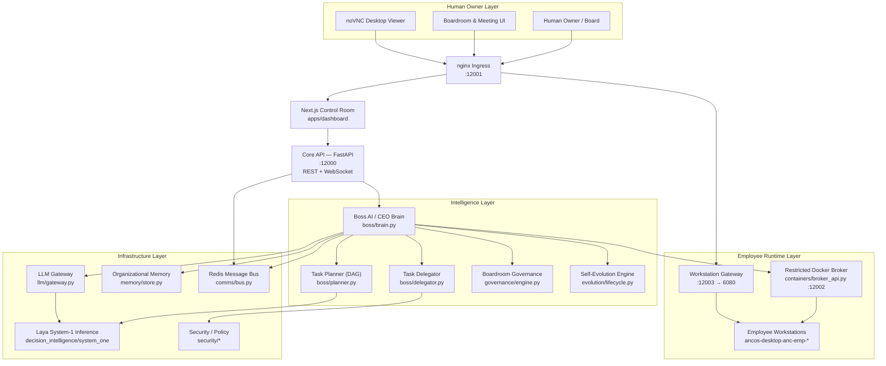

---

## 2. Deployment Topology (docker-compose)

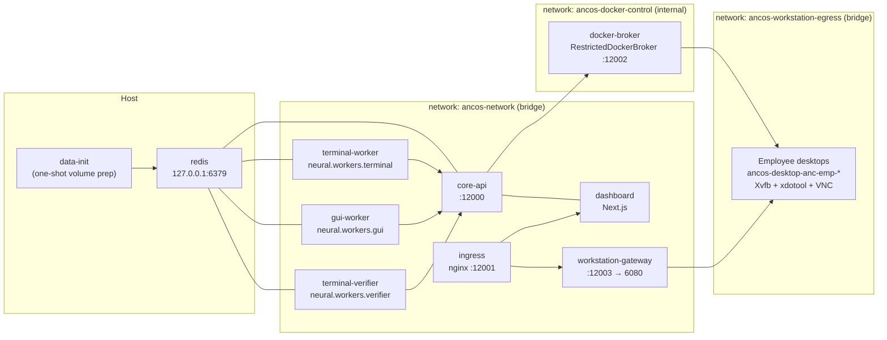

Notes:
- `docker-broker` sits on the internal-only `ancos-docker-control` network; the
  application never mounts `/var/run/docker.sock` directly.
- `workstation-gateway` and `ingress` bridge `ancos-network` with
  `ancos-workstation-egress` so browsers can reach noVNC.
- Ports bind to `ANCOS_BIND_HOST` (default `127.0.0.1`).

---

## 3. Boss Brain — Objective to Verified Delivery

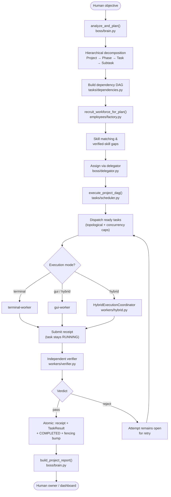

---

## 4. Task Worker Claim Protocol

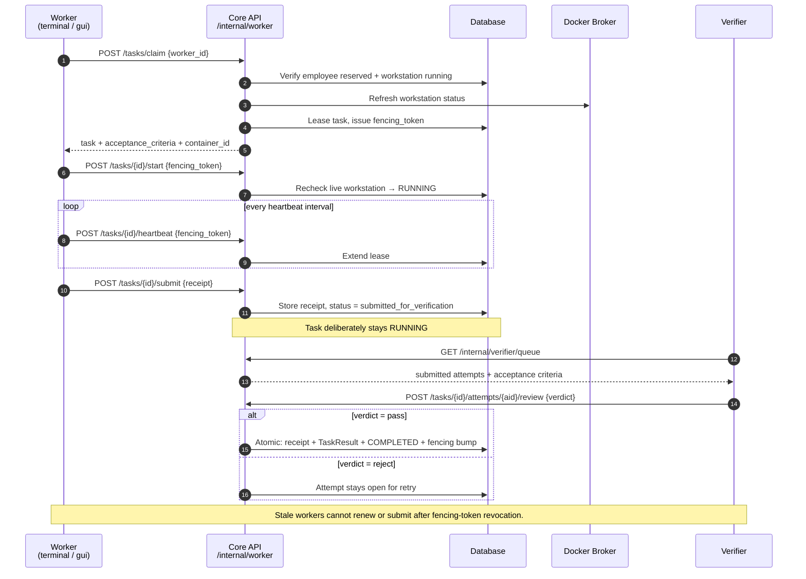

---

## 5. GUI Execution Loop (Visual-First, No Cheating)

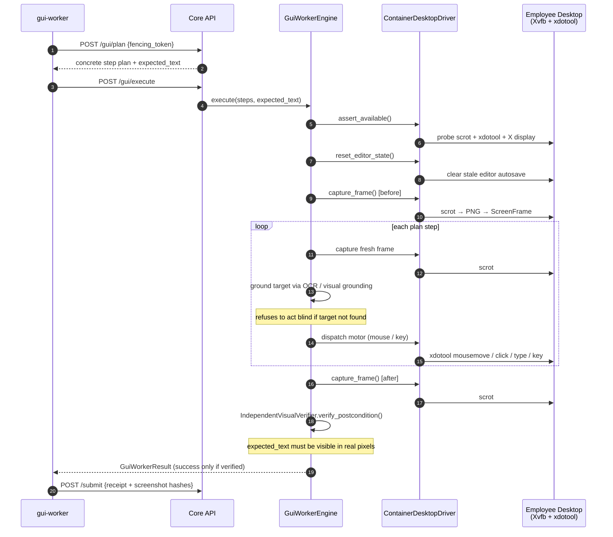

---

## 6. GUI Intelligence — Internal Architecture

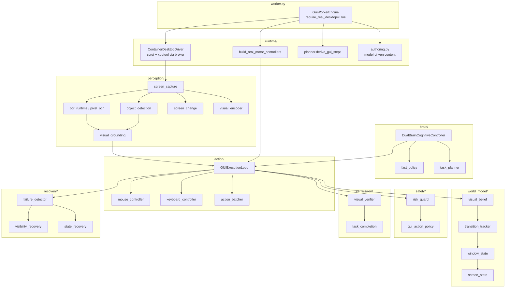

---

## 7. Laya Decision Intelligence (System 1)

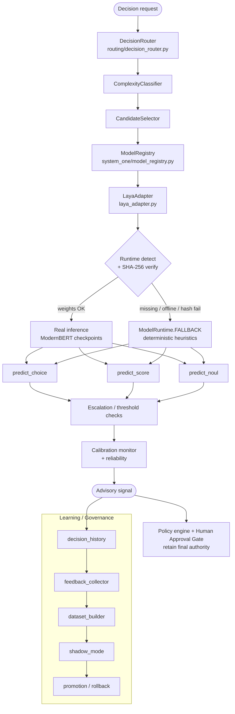

---

## 8. Data Model (core relationships)

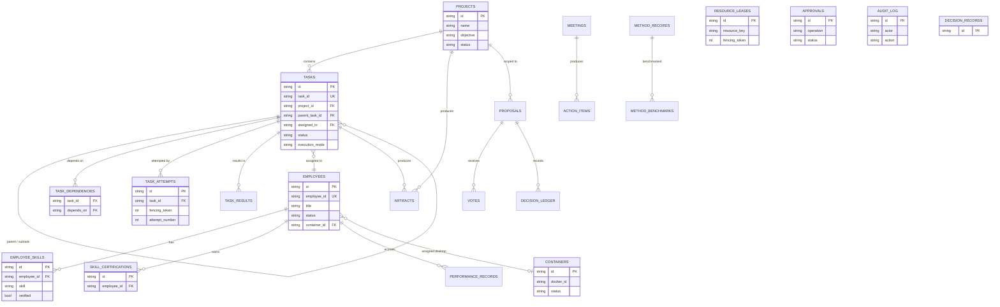

---

## 9. Self-Evolution Lifecycle

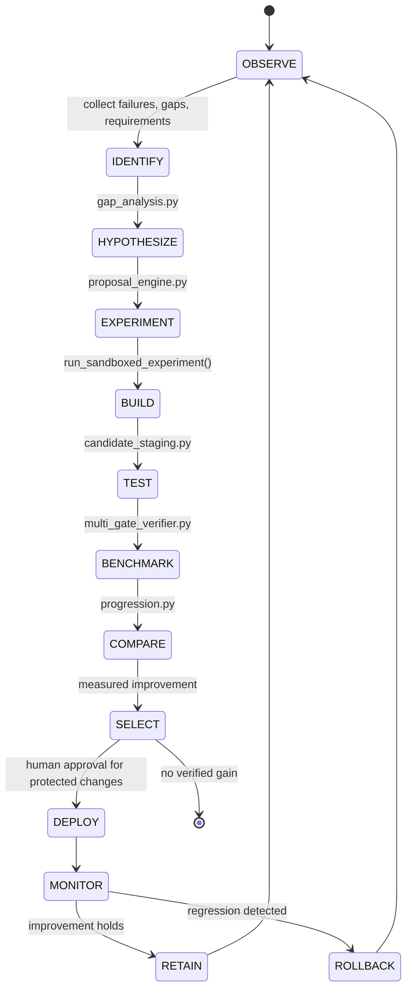

---

## 10. Governance & Boardroom

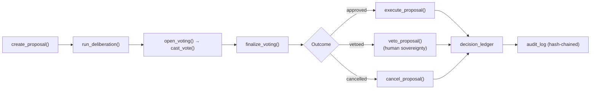

---

## 11. Security & Human Sovereignty

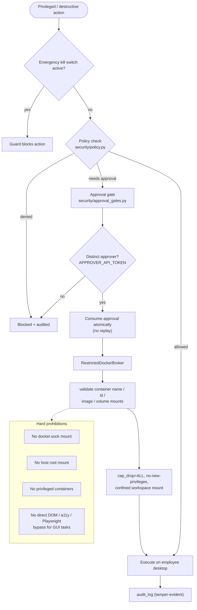

---

## Reality Notes

- **Live vs protocol-only.** The worker/verifier endpoints are real, credential-
  authenticated protocol surfaces. A full autonomous GUI run additionally needs a
  real desktop adapter and an independently operated verifier process; without them
  the system must not claim autonomous work completed.
- **Fallback behaviour.** Laya falls back to deterministic heuristics when weights
  are absent, offline, or fail SHA-256 verification; the policy engine and human
  approval gates keep final authority over privileged actions.
- **Databases.** `docker-compose.yml` runs on SQLite for the default profile; the
  code also supports PostgreSQL via `DATABASE_URL`. Alembic owns schema versioning.
