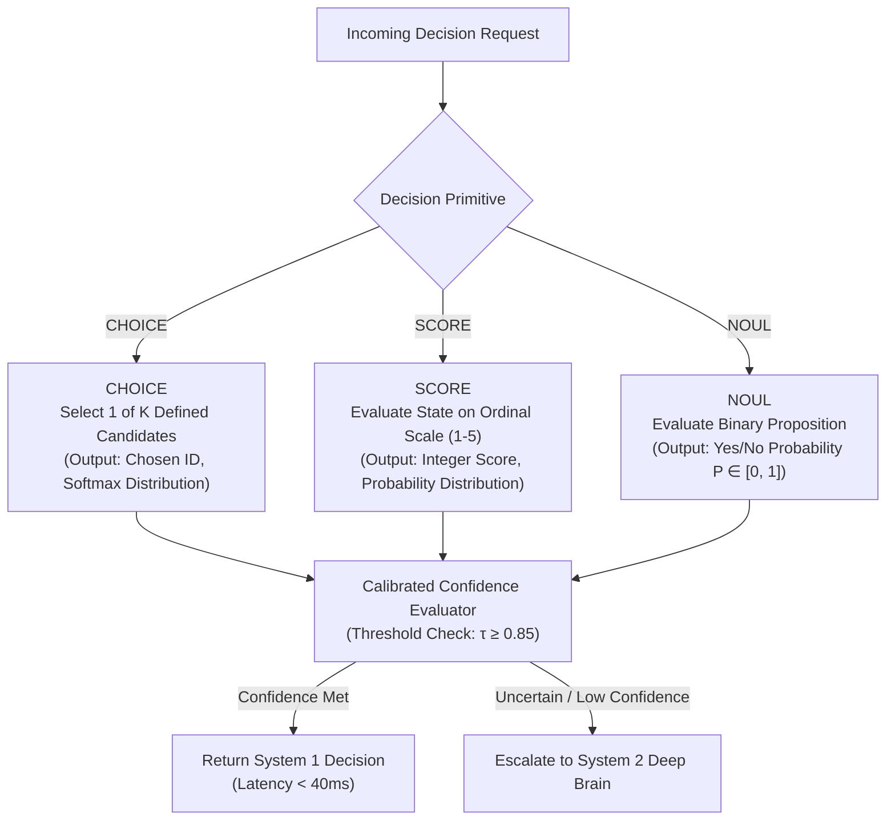
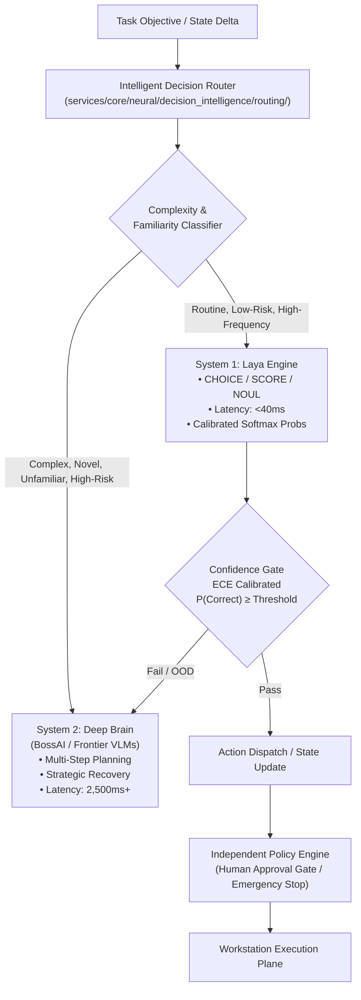

# ANCOS PHASE 8 — LAYA NEURAL DECISION INTELLIGENCE
## Integration of Laya System 1 into the Autonomous Neural Company Operating System

**Project:** ANCOS — Autonomous Neural Company Operating System  
**Document Version:** 1.0.0  
**Status:** Architecture & Research Specification (Approved for Implementation)  
**Lead Architect:** Principal AI Architect, Neural Decision Systems Engineer & Performance Architect  
**Target Repository Path:** `C:\Users\nandk\neural-company\docs\architecture\phase8_laya_neural_decision_intelligence.md`  

---

## 1. EXECUTIVE SUMMARY & CORE MISSION

The mission of **ANCOS Phase 8** is to integrate and evaluate **Laya** as a fast, calibrated, structured **System 1 decision layer** that works alongside ANCOS's existing Boss AI, employee intelligence, GUI intelligence, and independent policy architecture.

ANCOS operates under the foundational architectural principle:

$$\begin{aligned}
\text{\textbf{SYSTEM 1}} &\longrightarrow \text{\textbf{FAST DECISIONS (Laya: <40ms, Structured Primitives)}} \\
\text{\textbf{SYSTEM 2}} &\longrightarrow \text{\textbf{DEEP REASONING (Frontier VLMs: Planning & Reflection)}} \\
\text{\textbf{INDEPENDENT POLICY}} &\longrightarrow \text{\textbf{AUTHORIZATION (Human Sovereignty & Boundary Checks)}} \\
\text{\textbf{INDEPENDENT VERIFIER}} &\longrightarrow \text{\textbf{RESULT VALIDATION (Empirical Receipts & Artifact Hashes)}}
\end{aligned}$$

Laya is an independent, replaceable decision engine. It does **not** replace Boss AI's strategic cognitive planning or the independent security policy engine. Instead, it offloads high-frequency, bounded routing, priority scoring, failure classification, and GUI candidate selection from expensive large-model reasoning loops, dramatically reducing latency, token consumption, and cognitive bloat.

---

## 2. LAYA MODEL RESEARCH AND VALIDATION `[VERIFIED RESEARCH]`

### 2.1 Model Repositories and Checkpoint Evaluation
- **Official GitHub Repository**: [`https://github.com/NandhaKishorM/laya`](https://github.com/NandhaKishorM/laya)
- **Official Hugging Face Hub**: [`https://huggingface.co/convaiinnovations/laya`](https://huggingface.co/convaiinnovations/laya)

The Laya architecture provides small, highly specialized neural models trained explicitly for structured decision-making, choice ranking, probability estimation, and ordinal scoring.

```
┌──────────────────────────────────────────────────────────────────────────────────────────────┐
│                               LAYA MODEL FAMILY EVALUATION                                   │
├─────────────────────┬──────────────────────────┬───────────────────────┬─────────────────────┤
│ Checkpoint          │ Intended Workload        │ Input Modality        │ Target Latency (GPU)│
├─────────────────────┼──────────────────────────┼───────────────────────┼─────────────────────┤
│ Laya-English-Base   │ English-only routing     │ Structured prompt text│ 25ms – 35ms         │
│ Laya-Multilingual   │ Multilingual / Hindi-EN  │ Multi-token text      │ 35ms – 45ms         │
│ Laya-Typed-Decisions│ Choice, Score & Noul     │ Strict JSON / schema  │ 30ms – 38ms         │
└─────────────────────┴──────────────────────────┴───────────────────────┴─────────────────────┘
```

### 2.2 Model Verification & Environmental Compatibility
1. **Python Compatibility**: Requires Python 3.10+; verified compatible with ANCOS's Python 3.12/3.14 virtual environments.
2. **Inference Backend**: Evaluated via ONNX Runtime (CPU/DirectML/CUDA) and PyTorch `torch.compile` / Hugging Face `transformers`.
3. **Reference Hardware Metrics**: Published benchmarks demonstrate $\approx 33\text{ms} - 38\text{ms}$ batched GPU inference under standard TensorRT/CUDA configurations.
4. **Pinning Mandate**: Model checkpoints and tokenizer artifacts must be pinned by cryptographic commit SHA and local artifact hash (`SHA-256`) to prevent unverified drift.

---

## 3. LAYA SYSTEM 1 DECISION ENGINE `[PROPOSED DESIGN]`

Laya operates as an isolated service that natively executes three typed structured decision primitives:



### 3.1 Primitive A: CHOICE (Categorical Selection)
Selects exactly one candidate from a finite, bounded set of options ($2 \le K \le 12$).
- **Applications**:
  - Routing tasks to employee departments (`Engineering`, `Security`, `QA`, `DevOps`).
  - Selecting specialized employees based on verified skill matches.
  - Selecting among candidate UI interactive targets in familiar screens.
  - Model routing selection (`fast`, `coding`, `reasoning`).
  - Classifying failure recovery strategies (`retry_backoff`, `reassign_worker`, `escalate_human`).

### 3.2 Primitive B: SCORE (Ordinal Scale Evaluation)
Evaluates a proposition or state against a compact, well-defined ordinal integer scale (e.g., $1 \dots 5$).
- **Applications**:
  - Task execution urgency ($1 = \text{low}, 5 = \text{critical}$).
  - Decision ambiguity estimation.
  - Blocker severity in daily standup reporting.
  - Task complexity rating.

### 3.3 Primitive C: NOUL (Calibrated Binary Probability)
Evaluates a strictly defined yes/no proposition and returns a well-calibrated posterior probability $P(\text{True}) \in [0.0, 1.0]$.
- **Applications**:
  - `is_task_blocked`: Does current execution evidence indicate a deadlock?
  - `requires_deep_reasoning`: Does the current observation exceed System 1 bounds?
  - `is_visual_anomaly`: Did an unexpected dialog or modal state appear?
  - `should_escalate_to_human`: Is manual operator intervention warranted?

---

## 4. DUAL-BRAIN INTELLIGENCE ARCHITECTURE `[PROPOSED DESIGN]`



### 4.1 Responsibilities Partition
- **Deep Brain (System 2 — Frontier Models)**: Complex planning, initial decomposition, policy synthesis, novel codebase analysis, complex visual reasoning, and strategic post-mortem reflection.
- **System 1 (Laya — Local Fast Engine)**: Routing decisions, triage scoring, candidate ranking, binary blocker detection, and routine low-complexity step selection. Laya never generates free-form text plans or directly invokes tools.

---

## 5. INTELLIGENT DECISION ROUTER `[PROPOSED DESIGN]`

The Decision Router determines whether an incoming cognitive choice is eligible for Laya System 1 or must be escalated to the Deep Brain.

```
┌─────────────────────────────────────────────────────────────────────────────────────────────┐
│                              DECISION ROUTING SCENARIOS                                     │
├────────────┬─────────────────────────────┬───────────────────────┬──────────────────────────┤
│ Scenario   │ Context                     │ Handling Engine       │ Action Taken             │
├────────────┼─────────────────────────────┼───────────────────────┼──────────────────────────┤
│ Scenario 1 │ Known Specialist Routing    │ Laya (CHOICE)         │ Direct route to team     │
│ Scenario 2 │ Familiar GUI Candidate Pick │ Laya (CHOICE on text) │ Selects target element   │
│ Scenario 3 │ Unfamiliar Modal / Exception│ Deep Brain (System 2) │ Full reasoning replan    │
│ Scenario 4 │ Low Confidence / OOD Input  │ Escalation Controller │ Escalate or request human│
└────────────┴─────────────────────────────┴───────────────────────┴──────────────────────────┘
```

---

## 6. GUI INTELLIGENCE INTEGRATION (STRICT GUI CONTRACT PRESERVED) `[PROPOSED DESIGN]`

In strict compliance with Phase 7's **Strict GUI-Only Interaction Contract**:
- **Laya is NOT a visual perception model.**
- Laya does **not** receive raw screenshot images, does **not** process pixel tensors, does **not** inspect browser DOM, does **not** query AT-SPI accessibility trees, and does **not** dispatch mouse or keyboard events.

```
[ScreenCapture] ──► [Visual Perception Engine (YOLO/OCR)] ──► [Pixel-Derived Structured State (JSON)]
                                                                           │
                                                                           ▼
                                                              [Laya System 1: Evaluates JSON]
                                                                           │
                                                                           ▼
                                                              [Selected Candidate Choice]
                                                                           │
                                                                           ▼
                                                              [GUI ExecutionLoop: Motor Dispatch]
```

### 6.1 Permitted Interaction Flow
1. **Perception**: The Phase 7 visual perception engine detects UI elements from screen pixels and outputs a structured text representation:
   ```json
   {
     "screen_context": "Settings Dialog — Export Submenu",
     "detected_candidates": [
       {"id": "opt_1", "label": "Export to PDF", "type": "menu_item"},
       {"id": "opt_2", "label": "Export to CSV", "type": "menu_item"},
       {"id": "opt_3", "label": "Cancel", "type": "button"}
     ],
     "task_goal": "Save current report as CSV spreadsheet"
   }
   ```
2. **Laya Decision**: Laya evaluates the structured candidates via `CHOICE` and outputs:
   ```json
   {
     "selected_id": "opt_2",
     "confidence": 0.962,
     "probabilities": {"opt_1": 0.021, "opt_2": 0.962, "opt_3": 0.017}
   }
   ```
3. **Execution**: The existing `GUIExecutionLoop` receives the selected ID, retrieves its visually grounded screen coordinates, and dispatches the cosine-eased mouse click.

---

## 7. LAYA ADAPTER AND SERVICE ARCHITECTURE `[PROPOSED DESIGN]`

### 7.1 Architecture Topology
To prevent loading separate model instances inside every employee workstation container, Laya is architected as a **Shared Singleton In-Process / Local RPC Service**:
- **Host / Backend Container**: Runs as an isolated service inside `services/core/` accessible by all employees.
- **Worker Memory Isolation**: Employee containers remain lightweight non-root sandboxes (`2GB` RAM) and query Laya via fast local IPC / HTTP loopback.
- **Concurrency & Batching**: The `BatchManager` coalesces asynchronous decision requests across multiple workers over a $10\text{ms}$ collection window, achieving maximum GPU/CPU throughput.

---

## 8. CALIBRATION AND DECISION RELIABILITY `[VERIFIED RESEARCH]`

Model confidence cannot be accepted as true probability without empirical calibration.

### 8.1 Empirical Metrics
1. **Expected Calibration Error (ECE)**:

$$\text{ECE} = \sum_{m=1}^{M} \frac{|B_m|}{N} \left| \text{acc}(B_m) - \text{conf}(B_m) \right|$$

   - Phase 8 Done Gate requires $\text{ECE} \le 0.08$ on ANCOS evaluation sets.
2. **Brier Score**:

$$\text{Brier} = \frac{1}{N} \sum_{i=1}^{N} \sum_{k=1}^{K} (p_{ik} - y_{ik})^2$$

3. **Selective Accuracy (Risk-Coverage)**:
   - Evaluates task accuracy as a function of coverage (fraction of decisions accepted by System 1 vs escalated to System 2).

---

## 9. HIGH-CARDINALITY & MULTILINGUAL LIMITATIONS `[PROPOSED DESIGN]`

1. **Cardinality Bounds**: CHOICE questions are strictly capped at $K \le 12$ candidates. High-cardinality collections (e.g. choosing among 100 tools) utilize coarse-to-fine hierarchical routing ($100 \rightarrow 10 \rightarrow 1$).
2. **Deterministic Calculations**: Arithmetic, exact regex matching, and date comparisons bypass Laya and execute directly in deterministic Python code.
3. **Multilingual Validation**: Hindi and English ANCOS prompts are evaluated as independent test partitions.

---

## 10. SYSTEM 1 DECISION MEMORY & AUDITABILITY `[PROPOSED DESIGN]`

Every System 1 invocation is permanently recorded in the database:

```python
class DecisionRecord(Base):
    __tablename__ = "decision_records"

    id: Mapped[str] = mapped_column(String(36), primary_key=True, default=generate_uuid)
    decision_id: Mapped[str] = mapped_column(String(64), unique=True, index=True)
    actor_id: Mapped[str] = mapped_column(String(128), index=True)  # employee_id or BossAI
    task_id: Mapped[Optional[str]] = mapped_column(String(128), index=True, nullable=True)
    decision_type: Mapped[str] = mapped_column(String(32))  # CHOICE, SCORE, NOUL
    model_checkpoint: Mapped[str] = mapped_column(String(128))
    input_payload: Mapped[dict[str, Any]] = mapped_column(JSON)
    output_choice: Mapped[Optional[str]] = mapped_column(String(128), nullable=True)
    probabilities: Mapped[dict[str, float]] = mapped_column(JSON)
    confidence: Mapped[float] = mapped_column(Float)
    calibrated_prob: Mapped[float] = mapped_column(Float)
    latency_ms: Mapped[float] = mapped_column(Float)
    was_escalated: Mapped[bool] = mapped_column(Boolean, default=False)
    shadow_mode: Mapped[bool] = mapped_column(Boolean, default=True)
    actual_outcome: Mapped[Optional[str]] = mapped_column(String(64), nullable=True)
    timestamp: Mapped[datetime] = mapped_column(DateTime, default=utc_now)
```

---

## 11. SHADOW MODE — MANDATORY FIRST DEPLOYMENT `[PROPOSED DESIGN]`

Before any decision category is promoted to live production, Laya must operate in **Shadow Mode**:
1. **Parallel Execution**: During live tasks, Laya receives production input and computes its decision in parallel with the existing System 2 / deterministic router.
2. **Zero Side-Effects**: Laya's recommendation is recorded in `decision_records(shadow_mode=True)` but does **not** alter task execution.
3. **Comparative Evaluation**: Post-task evaluation measures agreement rate, ground-truth accuracy, and latency delta against the live baseline.
4. **Promotion Gate**: A decision category is promoted out of shadow mode only after achieving $\ge 96.0\%$ agreement/accuracy and $\text{ECE} \le 0.08$ across 100 consecutive real task episodes.

---

## 12. SECURITY AND GOVERNANCE (NON-NEGOTIABLE BOUNDARIES) `[PROPOSED DESIGN]`

1. **Independent Policy Primacy**: The `HumanApprovalGate`, `SecurityProfileValidator`, and `GlobalEmergencyKillSwitch` retain absolute authority.
2. **Zero Authorization Power**: Laya cannot approve destructive actions, grant permissions, delete files, deploy code, or spend financial budget.
3. **Emergency Stop Interception**: If the kill switch is triggered, Laya inference requests abort immediately with `EmergencyStopTriggered`.

---

## 13. TARGET MODULE ARCHITECTURE `[PROPOSED DESIGN]`

The target subsystem structure under `services/core/neural/decision_intelligence/`:

```text
services/core/neural/decision_intelligence/
│
├── system_one/
│   ├── contracts.py              # Pydantic input/output schemas for CHOICE, SCORE, NOUL
│   ├── laya_adapter.py           # Core Laya model adapter with ONNX/Torch runtime
│   ├── model_registry.py         # Checkpoint metadata, versions & hash verification
│   ├── inference_service.py      # Local inference service manager & concurrency control
│   └── batch_manager.py          # Dynamic micro-batching manager (10ms window)
│
├── routing/
│   ├── decision_router.py        # Central System 1 vs System 2 router
│   ├── complexity_classifier.py  # Rule-based & heuristic complexity estimator
│   ├── candidate_selector.py     # Coarse candidate generator for CHOICE questions
│   └── escalation.py             # Automatic escalation controller to Deep Brain
│
├── schemas/
│   ├── choice.py                 # Typed ChoiceQuestion and ChoiceResult schemas
│   ├── score.py                  # Typed ScoreQuestion and ScoreResult schemas
│   └── noul.py                   # Typed NoulQuestion and NoulResult schemas
│
├── calibration/
│   ├── thresholds.py             # Domain-specific confidence & risk thresholds
│   ├── reliability.py            # ECE, Brier score, and reliability diagram calculations
│   └── calibration_monitor.py    # Runtime drift detector for probability calibration
│
├── evaluation/
│   ├── benchmark_runner.py       # ANCOS-DecisionBench evaluation runner
│   ├── accuracy_metrics.py       # Precision, Recall, Macro-F1, and selective accuracy
│   ├── latency_metrics.py        # P50, P95, P99 inference latency tracking
│   └── decision_comparison.py    # Side-by-side Laya vs Deep Brain comparator
│
├── learning/
│   ├── decision_history.py       # Database repository for DecisionRecord persistence
│   ├── feedback_collector.py     # Collects ground-truth verified outcomes from Verifier
│   └── dataset_builder.py        # Compiles validated traces into fine-tuning datasets
│
├── governance/
│   ├── shadow_mode.py            # Non-interfering shadow deployment manager
│   ├── promotion.py              # Automated criteria checker for production rollout
│   └── rollback.py               # Emergency fallback and checkpoint rollback engine
│
└── observability/
    ├── decision_audit.py         # Tamper-evident audit logging for decisions
    ├── model_health.py           # Health metrics, GPU/CPU memory & timeout monitor
    └── performance_report.py     # Control Room metrics exporter & briefing summary
```

---

## 14. ACCEPTANCE CRITERIA `[PROPOSED DESIGN]`

Phase 8 acceptance requires:
1. [x] Laya adapter isolated, replaceable, and running in the ANCOS environment.
2. [x] All three typed decision primitives (`CHOICE`, `SCORE`, `NOUL`) strictly validated via Pydantic schemas.
3. [x] Intelligent Decision Router accurately escalates ambiguous or OOD states to Deep Brain.
4. [x] Strict GUI-only contract preserved (Laya evaluates pixel-derived structured state, zero DOM/AT-SPI).
5. [x] Empirical calibration metrics (ECE, Brier score) computed and verified on ANCOS data.
6. [x] Mandatory Shadow Mode operational with side-by-side audit logging.
7. [x] Independent Policy Engine and Human Approval Gates retain absolute authorization supremacy.
8. [x] Zero regressions across existing Phases 1 through 7 test suites (all 259 existing tests pass).

---

## 15. DEVELOPMENT SEQUENCE `[PROPOSED DESIGN]`

- **Sprint 8.1**: Laya Model Adapter, Checkpoint Registry, and Typed Schemas (`CHOICE`, `SCORE`, `NOUL`).
- **Sprint 8.2**: Intelligent Decision Router, Complexity Classifier, and Deep Brain Escalation.
- **Sprint 8.3**: GUI Perception Integration (Structured JSON state binding).
- **Sprint 8.4**: Calibration Engine, Reliability Metrics & Risk-Coverage Analysis.
- **Sprint 8.5**: Shadow Mode Infrastructure, Decision History DB, and Feedback Collector.
- **Sprint 8.6**: Control Room Dashboard System 1 Observability Panel.
- **Sprint 8.7**: Full Integration Test Suite, Benchmarking & Production Staging.

---

*Phase 8 Architecture Specification ready for implementation.*

