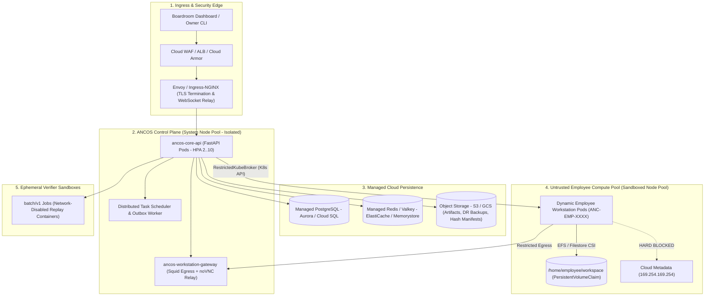

# ANCOS Cloud Infrastructure & Multi-Host Deployment Blueprint

## Executive Overview

This blueprint outlines the future enterprise cloud architecture for **ANCOS** (Autonomous Neural Company Operating System). It defines how ANCOS transitions from a single-host developer environment (running local Docker Compose) to a highly available, multi-tenant, cloud-native enterprise deployment running on **Kubernetes (EKS / GKE)** and provisioned via **Terraform**.

---

## 1. High-Level Cloud Architecture



---

## 2. Directory Structure & Modular Breakdown

The `infra/` directory is partitioned into declarative Infrastructure-as-Code (**Terraform**) and container orchestration manifests (**Kubernetes / Helm**):

```
infra/
├── README.md                       # This master cloud blueprint
├── terraform/                      # Cloud Resource Provisioning
│   ├── modules/
│   │   ├── vpc/                    # Multi-AZ VPC, private subnets, NAT gateways
│   │   ├── security/               # Security groups, metadata blocking, WAF rules
│   │   ├── database/               # Managed PostgreSQL (Aurora/Cloud SQL) & Redis
│   │   ├── storage/                # S3/GCS buckets, KMS keys, EFS/Filestore CSI
│   │   ├── iam/                    # OIDC Workload Identity (AWS IRSA / GCP WIF)
│   │   └── k8s_cluster/            # EKS or GKE cluster with dual node pools
│   └── environments/
│       ├── dev/                    # Development environment state & tfvars
│       ├── staging/                # Staging environment (pre-production parity)
│       └── prod/                   # Production environment (Multi-AZ, strict HA)
│
└── k8s/                            # Container Orchestration & Helm Charts
    ├── charts/
    │   ├── ancos-core/             # Control plane services (API, Gateway, Outbox)
    │   │   ├── Chart.yaml
    │   │   ├── values.yaml
    │   │   └── templates/
    │   │       ├── deployment-api.yaml
    │   │       ├── deployment-gateway.yaml
    │   │       ├── service-ingress.yaml
    │   │       ├── hpa.yaml
    │   │       └── network-policies.yaml
    │   └── ancos-workstations/     # Employee Workstation namespace templates
    │       ├── Chart.yaml
    │       ├── values.yaml
    │       └── templates/
    │           ├── namespace.yaml
    │           ├── pod-security-standards.yaml
    │           ├── resource-quotas.yaml
    │           ├── egress-network-policy.yaml
    │           └── pod-template.yaml
    └── crds/                       # Custom Resource Definitions (Future: Workstation CRD)
```

---

## 3. The Core Evolution: `RestrictedDockerBroker` ➔ `RestrictedKubeBroker`

In local development, ANCOS manages containers via `/var/run/docker.sock`. Mounting the Docker socket in a production Kubernetes cluster violates zero-trust principles. In the cloud, ANCOS evolves to use **Kubernetes Pods as Workstations**:

| Dimension | Local Docker (`RestrictedDockerBroker`) | Cloud Kubernetes (`RestrictedKubeBroker`) |
|---|---|---|
| **API Boundary** | Unix socket `/var/run/docker.sock` | K8s REST API (`kubernetes_asyncio` via In-Cluster Config) |
| **Workstation Identity** | Container name: `ancos-desktop-anc-emp-*` | Pod name: `ancos-desktop-anc-emp-*` in `ancos-workstations` namespace |
| **Isolation Level** | Linux cgroups + `cap_drop: ALL` | **gVisor (`runsc`)** or **Kata Containers** runtime class |
| **Workspace Persistence** | Host volume mount (`./data/workspaces/{emp_id}`) | Dynamic Cloud CSI (`EFS` / `GCP Filestore` ReadWriteMany PVCs) |
| **Egress Enforcement** | Host iptables / Squid container | K8s `NetworkPolicy` + Cilium/Calico eBPF filtering |
| **VNC Streaming** | Fixed localhost port mapping (`127.0.0.1:12003`) | ClusterIP + Tokenized WebSocket Ingress route |

### Cloud Workstation Pod Specification (`pod-template.yaml`)

```yaml
apiVersion: v1
kind: Pod
metadata:
  name: ancos-desktop-anc-emp-0042
  namespace: ancos-workstations
  labels:
    ancos.ai/employee-id: "ANC-EMP-0042"
    ancos.ai/workstation-id: "WS-ENG-02"
    ancos.ai/tier: "untrusted-worker"
spec:
  runtimeClassName: gvisor            # Prevents container-to-host kernel escapes
  serviceAccountName: ancos-worker-sa # Has ZERO Kubernetes API privileges
  securityContext:
    runAsNonRoot: true
    runAsUser: 1000
    runAsGroup: 1000
    fsGroup: 1000
    seccompProfile:
      type: RuntimeDefault
  containers:
    - name: employee-workstation
      image: ancos-desktop-base:v1.2.0
      securityContext:
        allowPrivilegeEscalation: false
        readOnlyRootFilesystem: false
        capabilities:
          drop: ["ALL"]
      resources:
        limits:
          cpu: "2.0"
          memory: "4Gi"
        requests:
          cpu: "500m"
          memory: "1Gi"
      volumeMounts:
        - name: workspace
          mountPath: /home/employee/workspace
  volumes:
    - name: workspace
      persistentVolumeClaim:
        claimName: pvc-workspace-anc-emp-0042
```

---

## 4. Zero-Trust Cloud Security & Egress Hardening

Autonomous AI employees execute code, write files, and run tests. Cloud infrastructure must operate under the assumption that **worker code is potentially untrusted or flawed**.

1. **Anti-SSRF & Metadata Service Hardening:**
   - The cloud instance metadata service (`169.254.169.254/32`) is hard-blocked via Kubernetes `NetworkPolicy` and AWS/GCP VPC routing tables.
   - Workers cannot query IAM roles, STS tokens, or cloud provider secrets.
2. **Strict Dual Node Pools:**
   - **System Node Pool:** Hosts Core API, Redis, and Gateway. Tainted with `CriticalAddonsOnly=true:NoSchedule`.
   - **Agent Node Pool:** Autoscaling spot/on-demand instances running gVisor sandboxes where untrusted code executes in userspace kernel isolation.
3. **Workload Identity (Zero Long-Lived Static Keys):**
   - Core API pods authenticate to PostgreSQL, Redis, and Object Storage via temporary OIDC credentials (AWS IAM Roles for Service Accounts / GCP Workload Identity).
4. **Air-Gapped Verifier Sandbox:**
   - Deliverable test verification runs inside disposable Kubernetes `Jobs` with `hostNetwork: false` and a default-deny all network policy (pure air-gapped test execution).

---

## 5. Phased Future Implementation Playbook

When the engineering team begins cloud deployment, follow this 5-stage rollout:

```
[Stage 1: Hybrid State] ──> [Stage 2: Terraform Core] ──> [Stage 3: Control Plane Helm] ──> [Stage 4: KubeBroker] ──> [Stage 5: HA & Auto-Scaling]
```

### Stage 1: Hybrid Cloud State (Low Risk)
- Retain local/single-VM execution.
- Migrate SQLite to Managed Cloud PostgreSQL (Aurora / Cloud SQL).
- Move file-based disaster recovery backups to an S3/GCS bucket.
- Verify that `CostLedgerRepository` and `BudgetRepository` handle remote database latency.

### Stage 2: Terraform Foundation Provisioning
- Run `terraform apply` in `infra/terraform/environments/dev`:
  - Provisions VPC, dual node pool EKS/GKE cluster, and EFS/Filestore storage classes.
  - Generates IAM roles with least-privilege policies.

### Stage 3: Control Plane Helm Deployment
- Package `docker/Dockerfile.core` and `docker/Dockerfile.workstation-gateway` into cloud container registries (ECR / Artifact Registry).
- Deploy `charts/ancos-core`:
  - Run database migrations via an Alembic Kubernetes `pre-install` Helm hook.
  - Scale `ancos-core-api` pods behind an Application Load Balancer with TLS.

### Stage 4: `RestrictedKubeBroker` Implementation
- In `services/core/neural/containers/`, implement `KubeBroker` alongside `DockerBroker`.
- Swap container creation calls to Kubernetes Pod manifests.
- Connect tokenized VNC relay to pod-level ClusterIP endpoints.

### Stage 5: Multi-Region Disaster Recovery & Auto-Scaling
- Configure Kubernetes Horizontal Pod Autoscaler (HPA) based on task queue depth in Redis.
- Enable automated cross-region replication for PostgreSQL and S3/GCS artifact manifests.
- Exercise clean-room full disaster recovery using `DisasterRecoveryManager` against remote cloud backups.

---

## 6. How to Run & Validate in Future Sprints

### Prerequisites
- Terraform >= 1.8.0
- Helm >= 3.14.0
- Cloud CLI (`aws` or `gcloud`) configured with target infrastructure credentials.

### Deployment Commands (When Ready)

```bash
# 1. Initialize Terraform Infrastructure
cd infra/terraform/environments/dev
terraform init
terraform plan -out=tfplan
terraform apply tfplan

# 2. Configure kubectl Context
aws eks update-kubeconfig --name ancos-dev-cluster --region us-east-1

# 3. Deploy ANCOS Control Plane via Helm
cd ../../../k8s
helm upgrade --install ancos-core ./charts/ancos-core \
  --namespace ancos-system --create-namespace \
  -f ./charts/ancos-core/values-dev.yaml

# 4. Deploy Workstation Policies
helm upgrade --install ancos-workstations ./charts/ancos-workstations \
  --namespace ancos-workstations --create-namespace

# 5. Verify Pod Liveness
kubectl get pods -n ancos-system
kubectl get pods -n ancos-workstations
```

---
*Maintained by the ANCOS Architecture & Autonomous DevOps Team.*

